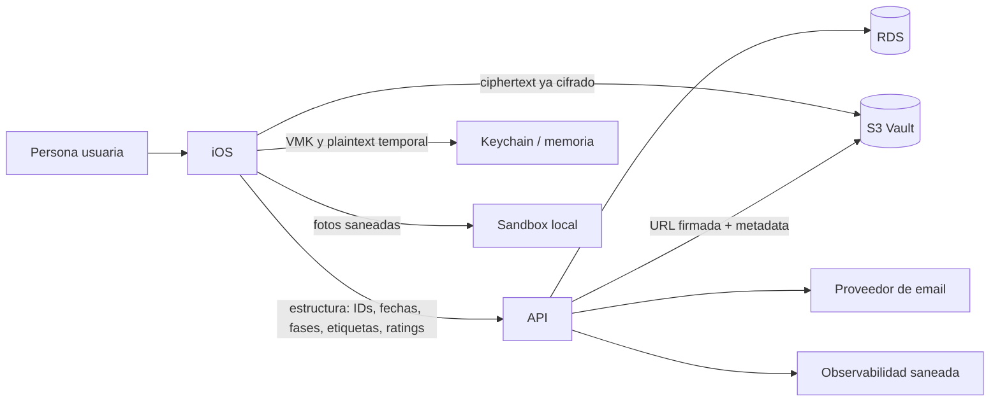

# Blueprint de Producto — MyDuckingLife (MDL)

> **Versión documental:** 1.0 — borrador funcional para revisión de Business/Product y preparación de conversaciones con asesoría.
> **Fecha de corte documental:** 3 de septiembre de 2026.
> **Ámbito:** propuesta de valor, alcance, actores, casos de uso, información tratada, arquitectura funcional y límites de la beta iOS.
> **Baseline solicitado:** estado objetivo posterior al cierre del Vault E2EE y a la implementación del nuevo modelo de relaciones por fases, etiquetas y períodos. Es una premisa de este documento, no evidencia de que esas iniciativas estén hoy cerradas en código.
> **Distribución de datos relacionales:** los IDs, códigos de catálogo, fechas, asociaciones y derivados necesarios para reglas, Timeline y estadísticas son estructura legible para API; las notas, descripciones, valores libres y cualquier dato que pueda contener PII viven en el Vault. Los campos todavía no definidos se identifican expresamente en §6.5.
> **Límite:** este blueprint no asigna bases jurídicas, no declara cumplimiento normativo y no sustituye el expediente de [`docs/legal/`](../legal/README.md).

## 1. Resumen ejecutivo

MyDuckingLife (MDL) es una aplicación iOS B2C para personas adultas que desean llevar un diario privado sobre personas de interés, experiencias y evolución de vínculos afectivos. No es una red social: no publica perfiles, no conecta a las personas descritas entre sí y no permite administrar contenido ajeno.

La propuesta de valor combina:

- un registro cronológico estructurado de crushes, experiencias y relaciones;
- contenido íntimo cifrado de extremo a extremo mediante el Private Journal Vault;
- fotos privadas conservadas únicamente en el dispositivo durante la beta;
- estadísticas personales calculadas sobre los datos estructurales de la propia cuenta;
- recuperación del Vault mediante contraseña de recuperación o frase de 24 palabras.

La separación de datos es deliberada:

1. iOS cifra el contenido privado antes de transferirlo; API y almacenamiento remoto reciben ciphertext y metadata, no la clave maestra ni el texto en claro;
2. API conserva los datos estructurales que necesita para autenticación, reglas cronológicas, Timeline y estadísticas;
3. las fotos no se sincronizan con MDL en la beta;
4. los datos estructurales, aunque no sean texto libre, pueden identificar o permitir inferencias íntimas y siguen sujetos a minimización, seguridad, retención y derechos.

### 1.1 Objetivo del documento

Este Blueprint explica MDL en términos comprensibles para una persona responsable de negocio o producto y, a la vez, conserva suficiente precisión para que equipos técnicos y asesoría identifiquen qué hace el sistema, qué información necesita y qué límites no deben prometerse.

No es un manual de pantallas, una especificación de API ni un texto legal. Los nombres de clases, endpoints, migraciones y pruebas permanecen en la documentación técnica de cada proyecto.

### 1.2 Beneficios esperados

- **Privacidad útil:** permitir un diario íntimo recuperable sin entregar al backend el contenido privado en claro.
- **Memoria estructurada:** reconstruir la historia de cada vínculo mediante crushes, experiencias, fases, etiquetas y períodos.
- **Claridad operativa:** distinguir entre un cambio guardado en el dispositivo, uno pendiente y uno sincronizado.
- **Autoconocimiento:** ofrecer estadísticas personales sobre la estructura de la propia cuenta, sin rankings ni comparaciones sociales.
- **Control:** permitir editar, archivar, eliminar y dar de baja con resultados visibles y sin falsos éxitos.
- **Evolución responsable:** separar estructura procesable, contenido E2EE y funciones futuras para que cada nueva finalidad pueda evaluarse antes de activarse.

## 2. Alcance y estado del producto

### 2.1 Incluido en la beta de lanzamiento

- registro, autenticación, cierre de sesión y recuperación de contraseña;
- aceptación versionada de términos y política de privacidad;
- verificación del control del email y protección de acciones sensibles cuando finalice su iniciativa activa;
- perfil de la cuenta y baja de cuenta;
- alta, consulta, edición, archivo y eliminación de crushes;
- experiencias y relaciones mediante fases, etiquetas, cierres y períodos con Timeline cronológico;
- Vault E2EE, sincronización durable y recuperación en un dispositivo sustituto;
- fotos locales saneadas, sin backup remoto de MDL;
- mapa aproximado por país y dashboard de estadísticas personales;
- español e inglés.

### 2.2 No incluido en la beta

- Android;
- perfiles públicos, mensajería o interacción social;
- panel de administración de contenido;
- pagos o suscripciones activas;
- backup remoto de fotos o videos;
- uso simultáneo normal del mismo Vault en varios dispositivos;
- tests de personalidad o apego como función final;
- notificaciones push completas;
- exportación portable completa del Vault;
- insights narrativos de IA con datos reales;
- estadísticas comparativas entre usuarios;
- almacenamiento remoto o análisis de texto libre relacional fuera del Vault.

No se consideran terminadas por la premisa especial de este documento la verificación de email, Sign in with Apple ni las validaciones todavía abiertas del guardado durable. Sólo deben presentarse como disponibles cuando sus iniciativas activas estén cerradas y la versión distribuida las exponga.

### 2.3 Restricciones de negocio

- Sólo pueden registrarse personas de 18 años o más.
- Cada cuenta accede únicamente a sus propios datos.
- La beta es gratuita.
- La persona descrita en un crush normalmente no tiene cuenta ni interacción directa con MDL.
- No existe un actor administrador en la aplicación. El acceso operativo a infraestructura, logs o soporte debe limitarse por rol, necesidad y trazabilidad.

### 2.4 Premisas funcionales

| ID | Premisa |
|---|---|
| PR-01 | MDL es un diario privado B2C para personas adultas; no es una red social ni un sistema para gestionar contenido ajeno. |
| PR-02 | Cada cuenta sólo puede operar sobre sus propios crushes, experiencias, relaciones, Vault y estadísticas. |
| PR-03 | La tercera persona descrita no crea una cuenta por aparecer en el diario y no recibe ninguna interacción de MDL. |
| PR-04 | iOS es la única capa que recibe la VMK y descifra el contenido privado del Vault. |
| PR-05 | API es fuente de verdad de IDs, códigos, fechas, asociaciones, invariantes y métricas estructurales. |
| PR-06 | El texto libre o potencialmente identificativo de crushes, experiencias y relaciones se cifra antes de salir del dispositivo. |
| PR-07 | Las fechas funcionales son días civiles `yyyy-MM-dd`; no se reinterpretan como instantes UTC para ordenar el diario. |
| PR-08 | Guardado local y sincronización remota son estados distintos. La interfaz no confirma sincronización sin evidencia de API y Vault. |
| PR-09 | La beta utiliza un único dispositivo activo por Vault; recovery sustituye el dispositivo y no habilita edición concurrente normal. |
| PR-10 | Un fallo de red, validación o autorización nunca se presenta como operación completada. |
| PR-11 | El baseline de relaciones de este documento es el modelo nuevo descrito en §6; la migración física y sus nombres de schema se definen durante la feature. |
| PR-12 | Las obligaciones legales, bases de tratamiento y plazos públicos sólo se fijan en el expediente Legal con aprobación profesional. |

## 3. Actores

| Actor | Papel | Interacciones principales |
|---|---|---|
| Persona visitante | Aún no autenticada | Registro, login, recuperación y consulta de textos legales vigentes |
| Persona usuaria | Titular de la cuenta | Gestiona su diario, Vault, fotos locales, perfil, estadísticas y baja |
| Tercera persona descrita | Persona incluida por el usuario en un crush | No crea cuenta, no recibe perfil público y no participa en el registro |
| iOS | Cliente de confianza para el Vault | Valida UI, cifra/descifra, custodia claves, conserva fotos y operaciones durables |
| API | Backend funcional | Autentica, autoriza, aplica reglas, conserva estructura y metadata, calcula estadísticas |
| Procesos programados | Operación técnica | Expiran sesiones/OTP, purgan datos elegibles y procesan inactividad |
| Proveedores | Infraestructura o servicios auxiliares | AWS, proveedor de email, Sentry y Google sólo cuando el flujo correspondiente esté activo |
| Personal autorizado | Seguridad, soporte u operación | Acceso excepcional y trazado a sistemas técnicos; nunca mediante un perfil social o panel de lectura del diario |

### 3.1 Matriz de acceso funcional

| Capacidad o información | Visitante | Persona usuaria | iOS con Vault desbloqueado | API/procesos | Personal autorizado |
|---|---:|---:|---:|---:|---:|
| Registro, login, recovery y textos legales | Sí | Sí | Intermedia | Ejecuta y registra estado | Sólo soporte técnico limitado |
| Datos estructurales de su cuenta | No | Sí | Presenta y modifica | Lee/procesa por necesidad funcional | Excepcional, por rol y trazabilidad |
| Plaintext del contenido Vault | No | Sí | Descifra temporalmente | No | No |
| Ciphertext y metadata Vault | No | No directamente | Sincroniza | Almacena/autoriza sin descifrar | Excepcional sobre metadata, nunca VMK/plaintext |
| Diario de otra cuenta | No | No | No | Sólo procesa bajo autorización del propietario correspondiente | No como función de soporte ordinaria |
| Estadísticas personales | No | Sí | Presenta | Calcula desde estructura autorizada | No como función ordinaria |
| Baja de cuenta | No | Inicia y confirma | Limpia estado local | Revoca, elimina o desidentifica según contrato | Sólo asistencia excepcional; no suplanta confirmación sin procedimiento aprobado |

La matriz expresa capacidades funcionales, no una base jurídica ni autorización laboral. Los accesos de infraestructura se definen y auditan fuera de la aplicación.

## 4. Mapa funcional y casos de uso

### 4.1 Catálogo de casos de uso

| ID | Caso de uso | Actor principal | Resultado esperado | Estado en este Blueprint |
|---|---|---|---|---|
| CU-01 | Registrarse e iniciar/cerrar sesión | Visitante / persona usuaria | Cuenta y sesión propias, con aceptaciones versionadas | Baseline de beta |
| CU-02 | Recuperar el acceso a la cuenta | Persona usuaria | Nueva contraseña de acceso tras desafío temporal | Baseline de beta |
| CU-03 | Configurar, desbloquear o recuperar el Vault | Persona usuaria | VMK disponible sólo en el dispositivo autorizado | Vault asumido terminado |
| CU-04 | Consultar y editar el perfil | Persona usuaria | Datos de cuenta actualizados bajo validación | Baseline de beta |
| CU-05 | Crear el bundle inicial de un crush | Persona usuaria | Crush, primer período relacional y experiencia opcional coherentes | Baseline de beta |
| CU-06 | Consultar, editar, archivar o restaurar un crush | Persona usuaria | Ficha y visibilidad actualizadas | Baseline de beta |
| CU-07 | Crear, editar, vincular o eliminar una experiencia | Persona usuaria | Timeline actualizado sin duplicados del mismo día | Baseline de beta |
| CU-08 | Evolucionar, cerrar, reabrir o corregir una relación | Persona usuaria | Períodos, fases y etiquetas coherentes | Modelo nuevo asumido terminado |
| CU-09 | Consultar y operar el Timeline | Persona usuaria | Cronología reconstruida desde entidades y pendientes | Baseline de beta |
| CU-10 | Consultar estadísticas personales | Persona usuaria | Métricas propias con estados vacíos y límites éticos | Baseline de beta |
| CU-11 | Eliminar una entidad del diario | Persona usuaria | Estructura, blobs y artefactos correspondientes retirados | Vault asumido terminado |
| CU-12 | Dar de baja la cuenta | Persona usuaria | Acceso revocado y ciclo de eliminación/desidentificación iniciado | Vault asumido terminado |

La verificación de email y Sign in with Apple son extensiones activas de CU-01/CU-04, pero no se declaran completas por la premisa de Vault y relaciones.

### 4.2 Flujo funcional común de escritura

1. La persona abre un formulario sobre su propia cuenta y, cuando hay contenido privado, desbloquea el Vault.
2. iOS precarga datos confirmados y, si corresponde, una proyección pendiente del mismo crush y dominio.
3. La persona completa los campos. La interfaz distingue obligatorios, opcionales y valores automáticos.
4. iOS valida formato y reglas conocidas, congela UUID y días civiles, y construye un snapshot coherente.
5. El snapshot se cifra y la intención se guarda localmente antes de utilizar la red.
6. La app puede comunicar “Guardado en este dispositivo”; todavía no comunica “Sincronizado”.
7. API recibe únicamente la estructura autorizada, aplica propiedad, invariantes e idempotencia y crea los bindings del Vault correspondientes.
8. iOS sincroniza el ciphertext, verifica la revisión remota y sólo entonces retira la intención pendiente.
9. La interfaz reconstruye la vista con la entidad confirmada y comunica el estado final.

Si el formulario sólo modifica datos de cuenta no pertenecientes al Vault, se omiten los pasos criptográficos que no correspondan, pero se conservan autorización, validación y confirmación real.

### 4.3 CU-01 y CU-02 — Cuenta, sesión y recuperación

**Objetivo.** Crear y recuperar una identidad de cuenta propia, mantener una sesión revocable y registrar las versiones legales aceptadas.

**Entradas principales.** Email normalizado, contraseña de acceso, fecha de nacimiento, aceptaciones requeridas y, cuando aplique, código temporal de recuperación. País, género y teléfono son datos de perfil sujetos a su obligatoriedad real en la interfaz vigente.

**Flujo principal.**

1. La persona consulta y acepta las versiones vigentes de términos y privacidad.
2. Crea una cuenta con email, contraseña y fecha de nacimiento; el producto puede pedir otros atributos de perfil opcionales.
3. La sesión tiene una duración máxima de siete días desde la emisión del token y puede revocarse antes.
4. Los flujos de recuperación y verificación usan códigos temporales enviados por email y respuestas diseñadas para evitar enumeración de cuentas.
5. Las credenciales de acceso y los secretos de recuperación del Vault son distintos.

**Resultado.** La persona accede únicamente a su namespace. Cerrar sesión revoca el token correspondiente y limpia el contexto sensible local sin eliminar la cuenta.

**Alternativas y límites.** Un código inválido, expirado o excedido no cambia la contraseña. La API contiene autenticación con Google, pero su exposición debe confirmarse contra la versión iOS publicada. Sign in with Apple y la verificación completa del email permanecen condicionados a sus planes activos.

### 4.4 CU-03 — Configuración, desbloqueo y recuperación del Vault

**Objetivo.** Mantener el contenido privado recuperable sin que API, S3 ni el personal operativo reciban la VMK o el plaintext.

**Precondiciones.** Cuenta autenticada, estado de Vault conocido y controles de seguridad de cuenta exigibles completados.

**Flujo principal.**

1. iOS genera una Vault Master Key (VMK) aleatoria por cuenta.
2. La VMK se mantiene en el dispositivo y se encapsula por separado para recuperación mediante contraseña y frase de 24 palabras.
3. API almacena las encapsulaciones y metadata necesarias, pero no recibe la VMK en claro.
4. En un dispositivo sin estado local, la app comprueba si existe un Vault remoto. Si existe, exige recovery y no crea otro Vault que lo sobrescriba.
5. La beta utiliza un único dispositivo activo por Vault. Recovery sustituye el dispositivo; no promete sincronización concurrente continua entre dos copias activas.

**Resultado.** La app publica el conjunto recuperado sólo después de descargar, descifrar y validar un inventario inequívoco. Un fallo conserva el Vault remoto y no crea otro encima.

**Alternativas y límites.** Una credencial de recovery incorrecta no entrega pistas sobre la VMK. La transferencia QR no es un método normal de beta. Perder todos los mecanismos de recuperación puede hacer irrecuperable el contenido E2EE.

### 4.5 CU-04 — Perfil y ajustes de cuenta

**Objetivo.** Consultar y modificar los datos de cuenta y preferencias sin confundirlos con el contenido del diario o las credenciales del Vault.

**Flujo principal.** El formulario se precarga con valores actuales. Cada cambio distingue valor nuevo, limpieza explícita y campo no modificado. La fecha de nacimiento se trata como día civil; el idioma se aplica y persiste; App Lock protege localmente una sesión ya autenticada.

**Datos.** Email, teléfono, fecha de nacimiento, país, género, idioma, plan y flags según las funciones realmente expuestas. Su tratamiento se detalla en §5.3.

**Alternativas y límites.** Cambiar contraseña o email puede exigir verificación adicional según las iniciativas activas. App Lock no revoca el token ni sustituye login/recovery. Un fallo no debe dejar la pantalla bloqueada ni mostrar datos de otra cuenta.

### 4.6 CU-05 — Crear el bundle inicial de un crush

**Objetivo.** Crear una ficha y el inicio de su cronología mediante una única intención durable.

**Precondiciones.** Sesión propia, Vault desbloqueado y ausencia de otra creación root pendiente para el mismo UUID.

**Entradas.** Los campos obligatorios y su ubicación se detallan en §5.3. La experiencia inicial es opcional como bloque, pero si se inicia debe quedar completa.

**Flujo principal.**

El alta crea un bundle inicial compuesto por:

- crush;
- primer período relacional obligatorio con fecha igual a `met_at`;
- experiencia inicial opcional y completa, también en `met_at`.

El cliente congela UUID y día civil antes de enviar. Un retry reutiliza la misma identidad y no crea un duplicado.

API recibe estructura como edad y fecha de referencia, país, género, categoría, rasgos, valoraciones, `met_at`, fase relacional y asociaciones. iOS cifra el nombre, profesión, contacto, redes, cumpleaños y demás contenido privado del perfil dentro del snapshot Vault.

**Resultado.** Lista, detalle y Timeline muestran una sola identidad de crush. Mientras sólo exista guardado local, la proyección se distingue del estado confirmado.

**Alternativas.** Un formulario incompleto no genera intención ni request. Un rechazo confirmado permite corregir o descartar; un resultado de red ambiguo se reconcilia reutilizando IDs antes de permitir un borrado normal.

### 4.7 CU-06 — Consultar y gestionar un crush

**Objetivo.** Consultar la ficha combinando estructura API y contenido Vault, editarla sin cambiar su identidad y controlar si aparece en la lista activa.

**Flujo principal.** iOS obtiene la estructura autorizada, resuelve el snapshot cifrado de la misma entidad y fusiona ambos por ID. Una edición conserva el UUID. Archivar modifica visibilidad, no elimina la ficha ni su historia; restaurar la devuelve a activos.

**Alternativas.** Si el Vault está bloqueado, no se muestra plaintext privado. Una edición de `met_at` sólo es válida si conserva el orden de los eventos posteriores y mueve con ella el bundle inicial.

### 4.8 CU-07 — Experiencias

**Objetivo.** Registrar un acontecimiento en un día civil, solo o vinculado a un cambio relacional.

**Entradas.** Fecha y satisfacción estructurales; lugar y descripción privados. Los campos exactos están en §5.3.

**Flujo principal.**

Una experiencia pertenece a un crush y a un día civil. Contiene fecha, satisfacción y asociaciones estructurales; lugar y descripción viven en el Vault cifrado.

Sólo puede existir una experiencia por crush y día. Una experiencia puede vincularse a un cambio de relación del mismo día y ambas se presentan como una unidad en el Timeline. El Timeline se reconstruye a partir de las entidades y sus correlaciones; no es una fuente independiente de datos.

**Edición y borrado.** La experiencia conserva su UUID al editarse. Si está vinculada, la fecha se mantiene alineada con el evento relacional. Eliminarla no elimina ni reabre la relación; libera el slot de experiencia de ese día.

### 4.9 CU-08 — Relaciones por fases, etiquetas y períodos

**Objetivo.** Representar cómo evoluciona un vínculo sin confundir fase de conexión, etiqueta elegida y motivo de cierre.

**Precondiciones.** Crush existente, Vault desbloqueado para cualquier texto libre y cronología compatible con las reglas de §6.

**Flujo principal.**

1. La persona selecciona una fecha y una fase permitida.
2. Si la fase es Involucrado, puede seleccionar la etiqueta estructurada que describe el vínculo.
3. Un cambio de etiqueta crea una entrada histórica; no sobrescribe retroactivamente los tramos anteriores.
4. Cerrar completa el período actual con fecha y motivo estructurado; una nota o explicación libre se cifra en Vault.
5. Reabrir crea un período nuevo y conserva el hueco temporal entre ambos.
6. iOS guarda la intención cifrada; API valida orden, unicidad, propiedad y códigos; Vault sincroniza el snapshot privado.

**Resultado.** Timeline y estadísticas pueden reconstruir fases, etiquetas, duración y reaperturas sin acceder a las notas privadas.

**Alternativas y límites.** Una experiencia posterior al cierre puede registrarse con advertencia, pero no reabre automáticamente el vínculo. El catálogo completo de motivos y el tratamiento de valores “Otro” se cierran durante la feature; ver §6.5.

### 4.10 CU-09 — Timeline

**Objetivo.** Presentar una cronología determinista de altas, experiencias y cambios relacionales.

**Flujo principal.** El sistema obtiene las entidades activas, agrupa las que comparten correlación y día, fusiona sus snapshots Vault y aplica proyecciones pendientes del mismo scope. El bundle inicial aparece una vez; una experiencia y un evento relacional vinculados aparecen como una unidad.

**Acciones.** Las acciones dependen del tipo de tarjeta, su identidad, su período y la seguridad de la información disponible. Una tarjeta histórica no ofrece mutaciones que la regla de dominio prohíba.

**Alternativas.** Datos insuficientes degradan una acción a sólo lectura. Los empates se ordenan de forma estable y una recarga no debe duplicar ni hacer desaparecer temporalmente una entidad.

### 4.11 CU-10 — Estadísticas personales

**Objetivo.** Resumir patrones de la propia cuenta mediante datos estructurales, sin convertir el diario en una clasificación de personas.

**Entradas.** IDs de catálogo, fechas, ratings, satisfacción, fases, etiquetas, duraciones y asociaciones estructurales autorizadas. El contenido Vault no se utiliza.

**Resultado.** La persona recibe métricas redondeadas y estados vacíos cuando la muestra no alcanza. No se presentan causalidades, comparaciones competitivas ni insights narrativos de IA en la beta.

### 4.12 CU-11 — Eliminación individual

**Objetivo.** Retirar una experiencia, relación o crush y todos los artefactos que dependan de esa entidad.

**Flujo principal.** La persona confirma; iOS resuelve pendientes; API aplica el borrado funcional y marca los blobs vinculados; iOS limpia entries y contenido local; la purga física remota ocurre después de la ventana técnica aplicable.

**Resultado.** La entidad deja de mostrarse y de alimentar funciones ordinarias. No se comunica éxito mientras alguna capa necesaria haya fallado.

### 4.13 CU-12 — Baja de cuenta

**Objetivo.** Revocar el acceso y ejecutar el ciclo integral descrito en §8.3.

**Flujo principal.** La persona recibe información sobre consecuencias, confirma, y el sistema revoca sesiones, retira Vault y recovery, elimina artefactos locales y procesa la estructura conforme a la política aprobada.

**Resultado.** No queda una sesión funcional ni un Vault recuperable por el flujo ordinario. Cualquier conservación posterior debe responder a finalidad, plazo y salvaguardas aprobados.

### 4.14 Resumen de archivo, borrado y baja

- Archivar oculta un crush de la lista activa sin eliminarlo.
- Eliminar una experiencia o relación elegible retira la entidad funcional y todas sus revisiones Vault asociadas.
- Eliminar un crush coordina estructura, relaciones, experiencias, bindings, blobs, entradas locales y fotos del dispositivo.
- Dar de baja la cuenta revoca sesiones, retira el Vault y sus mecanismos de recuperación, borra artefactos locales y desidentifica o elimina la estructura según la política aprobada.

El producto usa internamente la palabra “anonimización” para la sobrescritura irreversible de identificadores directos. Esa etiqueta técnica no determina que los registros restantes sean anónimos a efectos jurídicos; ver §8.3 y el expediente Legal.

### 4.15 Superficies funcionales

No se incluyen mockups ni capturas. Esta matriz identifica qué debe permitir cada superficie sin imponer un diseño visual concreto.

| Superficie | Información principal | Acciones principales |
|---|---|---|
| Acceso y textos legales | email, credencial, versiones vigentes y estado de sesión | registro, login, recuperación, aceptación y logout |
| Home / lista | crushes activos, estado derivado y cambios pendientes | abrir, buscar/filtrar según versión, iniciar alta y acceder a archivados |
| Alta y perfil de crush | estructura autorizada y contenido privado descifrado localmente | crear bundle, editar ficha, archivar, restaurar o eliminar |
| Experiencia | fecha, satisfacción, vínculo y texto Vault | crear, editar, vincular y eliminar |
| Relación | fase, etiqueta, período, cierre y nota Vault | avanzar, etiquetar, cerrar, reabrir y corregir donde esté permitido |
| Timeline | bundles, experiencias, períodos y estados pendientes | consultar y abrir únicamente las acciones válidas para cada tarjeta |
| Estadísticas | métricas personales, filtros y estados sin muestra | consultar sin acceder a contenido Vault |
| Vault y recovery | estado, método de recuperación y progreso | configurar, desbloquear y recuperar en dispositivo sustituto |
| Ajustes y perfil de cuenta | cuenta, idioma, App Lock y funciones disponibles | editar perfil, seguridad, logout y baja |
| Estado de sincronización | etapa, motivo saneado y alcance de la operación | cerrar, retry, corregir o descartar únicamente cuando sea seguro |

## 5. Modelo de dominio

### 5.1 Entidades principales

| Entidad | Propósito | Datos estructurales visibles para API | Contenido privado E2EE |
|---|---|---|---|
| User | Cuenta autenticada | UUID, email, password hash, fecha de nacimiento, país/género de perfil, plan, flags, sesión y aceptaciones | No aplica; son datos de cuenta, no Vault. El email es legible para el backend y el teléfono se cifra como campo con la clave de aplicación |
| Crush | Ficha privada de una tercera persona | UUID, edad y `age_as_of`, país, género, categoría, rasgos, ratings, `met_at`, archivo y derivados | nombre, profesión, contacto/redes, día/mes de cumpleaños y detalles privados |
| Experience | Acontecimiento con un crush | UUID, crush, fecha, satisfacción, correlación y vínculo con relación | lugar y descripción |
| Relationship / período | Evolución cronológica del vínculo | UUID, crush, fase, etiqueta catalogada, motivo catalogado, inicio/fin, historial de etiquetas, match status, correlación y experiencia vinculada | nota de cierre, explicación libre y texto asociado a valores personalizados |
| Vault | Contenedor E2EE de una cuenta | propietario, versión criptográfica y estado | No contiene plaintext en backend |
| VaultBlob | Revisión cifrada de una entidad | tipo, tamaño, hash, ruta, versión, secuencia, timestamps y soft delete | snapshot ciphertext |
| VaultEntityBinding | Vínculo opaco entre entidad y revisiones | tipo, ID funcional y token opaco | El token no revela el contenido sin VMK |
| VaultDevice / encapsulaciones | Recovery y autorización técnica | identificadores, fingerprints, fechas y estado | material encapsulado, nunca VMK en claro |
| ActivityEvent | Soporte del Timeline/feed | IDs de entidad, tipo de evento y fecha | No debe contener contenido Vault |
| AuditEvent / AuthEvent / SecurityAlert | Seguridad e investigación | IDs, ruta/evento, resultado, IP/user agent cuando proceda, trace ID y timestamps | No debe contener contenido Vault ni secretos |
| AccountDeletionFeedback | Gestión de la baja | motivo, texto opcional, estado y recibo | No pertenece al Vault; el texto libre debe evitarse o minimizarse y tratarse como potencialmente personal |

### 5.2 Catálogos y derivados

Los catálogos incluyen país, género, categoría Ducky, satisfacción, rasgos físicos, signo zodiacal, fase de conexión, etiqueta de vínculo, motivo de cierre, match status, plan y versiones legales.

Datos derivados principales:

- edad visible del usuario desde su fecha de nacimiento;
- edad actual estimada del crush desde `age`, `age_as_of` y, si existe, día/mes del cumpleaños cifrado;
- signo zodiacal calculado en iOS y enviado como categoría estructural;
- rating global como promedio de ratings disponibles;
- fase, etiqueta vigente, duración de tramos y match status desde el historial de relaciones;
- estadísticas personales desde la estructura de la cuenta.

Un derivado puede seguir siendo dato personal o revelar información sensible. “Calculado” no equivale a “anónimo”.

### 5.3 Matriz funcional de campos

Las tablas siguientes describen categorías funcionales. Los nombres físicos definitivos del nuevo modelo relacional se fijarán durante su feature y no se inventan en este Blueprint.

#### Cuenta

| Campo o grupo | Condición | Origen | Tratamiento principal |
|---|---|---|---|
| UUID de cuenta | Automático | API | Legible para API; identifica propietario y namespace |
| Email | Obligatorio en alta por email | Persona usuaria | Normalizado y legible para API; no pertenece al Vault |
| Contraseña de acceso | Obligatoria en alta por email | Persona usuaria | API conserva únicamente hash; no pertenece al Vault |
| Aceptaciones legales | Obligatorias cuando corresponda | Persona usuaria + versión publicada | API conserva documento, versión y evidencia temporal |
| Fecha de nacimiento | Según flujo de perfil/mayoría de edad | Persona usuaria | Dato de cuenta legible para API; la obligatoriedad final de la pantalla debe confirmarse |
| País y género de perfil | Según formulario vigente | Persona usuaria | IDs estructurados legibles para API |
| Teléfono | Opcional según producto publicado | Persona usuaria | Fuera del Vault; cifrado de campo con `APP_KEY` |
| Plan, flags y timestamps | Automáticos o funcionales | API/iOS | Estructura legible para API |
| Tokens de sesión | Automáticos | API | Secretos revocables; nunca se guardan en logs ni en el Vault |

#### Crush

| Campo o grupo | Condición | API/RDS | Vault E2EE |
|---|---|---:|---:|
| UUID, propietario y correlación | Automáticos | Sí | Puede formar parte del envelope/snapshot |
| Nombre | Obligatorio | No | Sí |
| Género | Obligatorio | ID estructurado | Copia en snapshot durante la beta; proporcionalidad a revisar |
| País y categoría Ducky | Obligatorios | IDs estructurados | Puede existir copia coherente en snapshot |
| `met_at`, edad y `age_as_of` | Obligatorios | Sí | Puede existir copia coherente en snapshot |
| Rasgos y ratings individuales | Opcionales; ratings sólo editables desde perfil | IDs/valores estructurados | Puede existir copia coherente en snapshot |
| Rating global | Derivado | API lo recalcula | No se acepta como verdad enviada por cliente |
| Profesión, contacto y redes | Opcionales | No | Sí |
| Día/mes de cumpleaños y detalles privados | Opcionales | No | Sí |
| Archivo, timestamps y derivados | Automáticos | Sí | No contienen texto privado |

#### Experiencia

| Campo o grupo | Condición | API/RDS | Vault E2EE |
|---|---|---:|---:|
| UUID, crush y propietario | Automáticos | Sí | Identidad del snapshot |
| Día civil | Obligatorio | Sí | Copia coherente dentro del snapshot durable |
| Satisfacción | Estructurada; en experiencia inicial forma parte del bloque todo-o-nada | ID estructurado | Puede existir copia coherente en snapshot |
| Lugar y descripción | Opcionales en experiencia normal; ambos requeridos si se inicia el bloque de experiencia inicial | No | Sí |
| Relación/correlación asociada | Opcional o automática | Sí | Puede existir copia coherente en snapshot |
| Timestamps y estado de borrado | Automáticos | Sí | Metadata, no contenido privado |

#### Relación y período — modelo objetivo

| Campo o grupo | Condición funcional | API/RDS | Vault E2EE |
|---|---|---:|---:|
| UUID, propietario y crush | Automáticos | Sí | Identidad del snapshot |
| Fase de conexión | Obligatoria | ID/código estructurado | Puede existir copia coherente en snapshot |
| Etiqueta de vínculo | Sólo durante Involucrado | ID/código estructurado | Puede existir copia coherente en snapshot |
| Historial de etiquetas | Automático, append-only | IDs y fechas | Sin texto libre |
| Inicio y fin de período | Inicio obligatorio; fin al cerrar | Sí | Copia coherente en snapshot |
| Motivo de cierre catalogado | Requerimiento final por definir para Cerrado | ID/código estructurado | Puede existir copia coherente en snapshot |
| Detalle “Otro”, explicación o nota de cierre | Opcional/condicional | No | Sí |
| Match status | Derivado del historial | Sí | No requiere plaintext |
| Experiencia y correlación vinculadas | Opcionales o automáticas | Sí | Identidad de asociación |
| Estado de migración legacy | Automático y transitorio | Código técnico mínimo | Nunca contiene el texto original en claro |

“Puede existir copia coherente en snapshot” significa que el dato puede quedar dentro del envelope cifrado para reconstrucción durable, pero no que sea secreto frente a API si también figura en la columna anterior.

### 5.4 Datos especialmente delicados

Aunque MDL no debe calificarlos jurídicamente por sí mismo, requieren especial cautela:

- contenido libre sobre vida afectiva o sexual;
- nombres, contactos, redes y cumpleaños de terceras personas;
- fases, etiquetas, motivos de cierre, fechas y satisfacción que permitan inferir intimidad;
- combinaciones poco frecuentes de atributos estructurados que faciliten reidentificación;
- credenciales, VMK, encapsulaciones, tokens, IP y contexto de seguridad.

No se incluyen estos valores en logs, mensajes de error, analítica de producto ni datos enviados al LLM.

## 6. Relaciones

### 6.1 Modelo funcional objetivo

Para este Blueprint, cada crush nace con un primer período relacional iniciado en `met_at`. El modelo deja de utilizar un único estado que mezcle avance, tipo de vínculo y cierre. En su lugar separa tres conceptos:

1. **Fase de conexión:** momento general en la evolución del vínculo.
2. **Etiqueta del vínculo:** forma elegida para describir un período involucrado.
3. **Motivo de cierre:** causa estructurada registrada cuando se cierra un período.

Esta separación evita que “Relación”, “Rechazado” o “Terminada” compitan como valores equivalentes cuando representan dimensiones diferentes.

### 6.2 Fases y etiquetas

Las fases acordadas son:

| Fase | Sentido funcional | Etiqueta de vínculo |
|---|---|---|
| Interesado | Existe interés inicial de la persona usuaria | No aplica |
| Conocido | Ya existe contacto o conocimiento personal | No aplica |
| Interés mutuo | Se percibe reciprocidad | No aplica |
| Involucrado | Existe un vínculo que la persona desea clasificar | Requiere una etiqueta válida |
| Cerrado | El período dejó de estar activo | No permanece una etiqueta activa; se conserva su historia |

Las etiquetas acordadas durante Involucrado son Citas, Casual, FWB, Relación y Otro. Los cambios de etiqueta son append-only: cada tramo conserva etiqueta, inicio y fin para que Timeline y estadísticas puedan calcular duración sin sobrescribir el pasado.

Si “Otro” permite una explicación escrita por la persona, el código `Otro` permanece en API y el texto se guarda exclusivamente en Vault. El texto no se convierte en catálogo global ni se usa para estadísticas.

### 6.3 Cierre, reapertura y correcciones

- Cerrar finaliza el período vigente y registra fecha y motivo catalogado.
- Una nota o explicación libre de cierre es opcional y E2EE.
- Reabrir crea un período separado; no borra ni estira el período anterior.
- Los días sin período activo se representan como un hueco temporal, no como una entidad ficticia.
- Un período iniciado y cerrado el mismo día dura un día civil.
- Una experiencia posterior a un cierre puede registrarse con advertencia, pero no reabre automáticamente el vínculo.
- Sólo el último período cerrado admite correcciones históricas acotadas de motivo, nota y fecha de cierre.
- Una corrección no puede producir solapamientos, invertir fechas ni alterar silenciosamente períodos anteriores.
- Las reglas exactas para eliminar un período del nuevo modelo deben quedar fijadas antes de implementar esa acción; este Blueprint no hereda automáticamente la semántica de borrado del enum anterior.

### 6.4 Match status, Timeline y estadísticas

El match status sigue siendo un derivado del historial y no una decisión manual independiente. La intención funcional acordada es monotónica: una vez que el historial produjo Sí, no retrocede.

Un período Involucrado puede producir Sí sin cambiar por sí mismo la fase siguiente. La propuesta contempla también que una experiencia íntima pueda producirlo, pero el criterio estructurado que identifica esa experiencia todavía debe definirse; hasta entonces no se documenta una inferencia automática basada en texto libre.

API puede usar fases, etiquetas, motivos catalogados, fechas y asociaciones para:

- reconstruir la fase y etiqueta vigentes;
- ordenar el Timeline;
- representar cierres, reaperturas y huecos;
- calcular duración por fase, etiqueta o período;
- producir estadísticas personales sin leer notas o descripciones.

Los códigos relacionales siguen siendo información sensible por contexto aunque no sean PII textual. Se minimizan, se aíslan por propietario y se someten a retención, derechos y evaluación jurídica.

### 6.5 Migración y decisiones pendientes de la feature

El corte desde los ocho estados legacy al modelo nuevo debe ser coordinado y no admite dual running ambiguo. Requiere backup, rollback, fecha de corte estadística, validación de inventario y una única representación activa después de migrar.

Decisiones ya fijadas:

- One-night stand migra a Involucrado + Casual.
- Un rechazo legacy cuya dirección no pueda conocerse utiliza un código técnico `REJECTED_LEGACY` hasta que la persona pueda corregirlo.
- La nota legacy se trata como contenido privado y termina en Vault.

Decisiones que este Blueprint deja deliberadamente abiertas, sin inventar valores:

| Decisión | Criterio ya fijado | Pendiente de completar |
|---|---|---|
| Nombres físicos de schema y contratos | API conserva códigos/fechas; Vault conserva texto libre/PII | nombres finales de tablas, columnas y payloads |
| Catálogo de motivos de cierre | Debe ser estructurado para reglas/estadísticas | lista, orden, localización y obligatoriedad |
| Valor “Otro” | Código en API; explicación en Vault | si existe, longitud, validación y presentación |
| Experiencia íntima y match status | No se infiere desde descripción privada | señal estructurada exacta o retiro de la regla |
| Mapeo legacy completo | No se pierde cronología ni se inventa certeza | correspondencia de los siete estados restantes |
| Eliminación/corrección de períodos | Sin solapamientos ni reescritura histórica amplia | acciones disponibles y límites exactos |
| Estadísticas posteriores al cambio | Sólo estructura propia y fecha de corte explícita | métricas afectadas y comparación pre/post migración |
| Retención y baja | Sigue el ciclo general de entidades y Vault | efecto exacto sobre historial append-only y backups |

Estas decisiones deben completarse en Product antes de implementar sus contratos. Mientras tanto, permiten a Business avanzar con flujos, lenguaje, pantallas y objetivos sin presentar nombres técnicos inexistentes como definitivos.

## 7. Mapa de datos y almacenamiento

| Capa | Qué conserva | Qué puede leer MDL/backend |
|---|---|---|
| Memoria de iOS desbloqueado | Plaintext necesario para mostrar/editar, VMK durante uso y proyecciones | La app en la sesión autorizada |
| Keychain | VMK y material local protegido | El dispositivo bajo sus controles de acceso |
| SQLite del Vault | Ciphertext, metadata, revisiones e intenciones durables | No hay índice privado persistente en plaintext |
| Sandbox de fotos | Imágenes saneadas por crush | Sólo el dispositivo; no se sincronizan con MDL |
| API/RDS | Cuenta, estructura, catálogos, aceptaciones, eventos, bindings, encapsulaciones y metadata | Backend y personal autorizado según controles |
| S3 Vault | Objetos ciphertext | El proveedor aloja objetos cifrados; no recibe VMK desde MDL |
| Email | Dirección y mensaje transaccional | API y proveedor de entrega según configuración |
| Observabilidad | Contexto técnico minimizado | IDs técnicos, rutas, estados y trazas; nunca contenido Vault |

### Flujo simplificado

La API no descifra Vault. Sí puede relacionar metadata y estructura con una cuenta mientras ésta esté activa, por lo que el conjunto no es anónimo.

## 8. Ciclo de vida, retención y baja

### 8.1 Durante la cuenta activa

- La estructura se conserva mientras sea necesaria para prestar la función.
- Cada entidad privada tiene una revisión vigente en Vault.
- Una edición sube y verifica la revisión nueva antes de retirar la anterior; la coexistencia es transitoria y no ofrece historial de versiones al usuario.
- Una operación durable pendiente se conserva cifrada hasta sincronizar, corregir o descartarse con seguridad.

### 8.2 Borrado individual

- El borrado funcional deja de mostrar o usar ordinariamente la entidad tras confirmación.
- Sus blobs quedan soft-deleted y son elegibles para purga física después de la ventana técnica de siete días.
- El binding opaco se conserva sólo para retry y purga, y se elimina al cerrar definitivamente el grafo.
- El efecto de backups, versionado de objetos y restauraciones debe estar documentado en la política pública aprobada.
- El borrado de un crush incluye sus descendientes, Vault y fotos locales; no basta con ocultar la fila principal.

### 8.3 Baja de cuenta y estadísticas posteriores

El objetivo funcional de la baja es:

1. revocar sesiones y accesos;
2. eliminar contenido Vault, encapsulaciones, bindings, dispositivos y artefactos locales;
3. retirar fotos locales;
4. sobrescribir identificadores directos de la cuenta y crushes;
5. retirar eventos funcionales que permitan reconstruir el diario;
6. conservar sólo lo que esté jurídicamente aprobado para obligaciones o estadísticas.

Product contempla conservar estructura desidentificada para estadísticas agregadas. Antes de hacerlo, la asesoría debe resolver una cuestión central: si se mantienen filas individuales enlazadas por UUID, secuencias o atributos raros, el resultado puede ser sólo seudonimizado y continuar siendo dato personal. El lanzamiento debe escoger y documentar una de estas salidas:

- agregación irreversible con eliminación posterior de las filas fuente; o
- retención de filas seudonimizadas con finalidad, base, plazo, acceso y salvaguardas expresos.

No se utilizará la palabra “anónimo” en textos públicos hasta que la asesoría apruebe la arquitectura concreta y su riesgo razonable de reidentificación.

### 8.4 Retenciones técnicas a someter a aprobación

| Categoría | Regla técnica de referencia | Observación |
|---|---|---|
| Token de sesión | 7 días desde emisión | Puede revocarse antes |
| ActivityEvent | Elegible después de 7 días, conservando hoy los 5 más recientes por cuenta | Ese remanente debe aprobarse o eliminarse |
| AuditEvent | 30 días | Evidencia forense; plazo jurídico a validar |
| AuthEvent | 90 días en el modelo actual | Seguridad/antiabuso; confirmar datos exactos y alinear herramientas operativas |
| SecurityAlert | 30 días | Seguridad; confirmar acceso y necesidad |
| Entidad estructural soft-deleted | 7 días | No aplica por sí sola a filas retenidas tras baja |
| VaultBlob soft-deleted | 7 días antes de purga | Confirmar ejecución, objetos, versiones y backups |
| OTP | Ventana operativa del flujo | Confirmar pruning y evidencias antifraude |
| Logs de proveedor/backups | Según configuración real | No se publica un plazo hasta obtener evidencia |

## 9. Estadísticas e IA

### 9.1 Estadísticas de beta

iOS consume el dashboard de estadísticas personales. API calcula métricas sobre la estructura de la cuenta y devuelve estados vacíos cuando la muestra no alcanza. Las áreas incluyen actividad, satisfacción, conversiones, ratings, países, zodíaco, rasgos, género, fases, etiquetas y duración relacional.

Reglas:

- sólo datos de la propia cuenta;
- escala de satisfacción 1..5 hacia el cliente;
- números redondeados a dos decimales;
- sin rankings de personas, “body count”, valor de mercado, predicción de fracaso o comparaciones competitivas entre usuarios;
- una inferencia expresa asociación, no causalidad;
- no se usan datos de usuario para entrenar modelos generales.

No hay estadísticas comunitarias activas en beta. Si algún día se incorporan, requerirán un modelo de agregación, umbral y riesgo de reidentificación aprobado antes de implementarse.

### 9.2 IA

La API contiene un payload estructurado para una integración futura, pero iOS y el servicio LLM no forman un flujo activo de beta. No se envían datos reales a un modelo por el mero hecho de existir ese endpoint.

Activar IA requerirá una decisión previa de Product y Legal sobre finalidad, entradas exactas, proveedor, región, retención, entrenamiento, transparencia, derechos, explicabilidad y pruebas. El texto libre del Vault no está autorizado como entrada.

## 10. Arquitectura funcional

### 10.1 Componentes

| Componente | Responsabilidad |
|---|---|
| iOS / SwiftUI | UI, validación local, cifrado/descifrado, custodia de VMK, Vault local, fotos y proyección de cambios pendientes |
| API / Laravel-PHP | Autenticación, autorización, estructura, invariantes, URLs firmadas, metadata Vault, Timeline y estadísticas |
| MySQL / RDS | Cuenta, estructura funcional, aceptaciones, eventos y metadata/encapsulaciones del Vault |
| S3 privado | Ciphertext de Vault mediante URLs firmadas temporales |
| Scheduler/queue | Pruning, purgas, inactividad y trabajos idempotentes autorizados |
| LLM/FastAPI | Prototipo no conectado a datos reales en beta |
| Product | Reglas canónicas, arquitectura transversal y expediente Legal |

### 10.2 Principios transversales

- UUID funcional estable e idempotencia de retries;
- autorización por propietario y aislamiento por cuenta/Vault;
- fechas de producto como días civiles `yyyy-MM-dd`;
- transacciones y locks para invariantes compartidas;
- errores saneados con trace ID;
- logs por allowlist, sin payloads completos ni secretos;
- una escritura se considera sincronizada sólo con evidencia verificable de API y Vault.

### 10.3 Flujo de lectura

1. iOS autentica la sesión y resuelve cuenta, namespace y estado del Vault.
2. API devuelve estructura autorizada sin contenido privado.
3. iOS obtiene las revisiones Vault que correspondan y las descifra localmente.
4. La app fusiona estructura, snapshot privado y proyección pendiente por identidad funcional.
5. Lista, detalle y Timeline se presentan sin duplicar una entidad por sus IDs internos de almacenamiento.

Si el Vault permanece bloqueado o una revisión no puede validarse, la app no sustituye el contenido por un valor inventado ni solicita a API un plaintext alternativo.

### 10.4 Diferencia entre lectura y escritura

| Aspecto | Lectura | Escritura |
|---|---|---|
| Finalidad | Consultar estado confirmado y proyecciones propias | Crear, modificar, archivar o eliminar |
| API | Devuelve estructura autorizada | Valida, autoriza y aplica invariantes/idempotencia |
| Vault | iOS descarga y descifra localmente | iOS cifra, persiste intención y sincroniza ciphertext |
| Confirmación | La vista distingue ausente, bloqueado y error | Guardado local no equivale a sincronizado |
| Sin red | Puede mostrar estado local disponible con su alcance | Conserva pendiente sin confirmar éxito remoto |
| Conflictos | Fusiona por UUID y scope | Reserva crush/dominio y reconcilia antes de repetir |

## 11. Proveedores y destinatarios

| Servicio | Estado de beta | Datos previstos | Punto a confirmar |
|---|---|---|---|
| AWS RDS/EC2 | Infraestructura prevista/activa | Cuenta, estructura, eventos y metadata Vault | entidad contratante, región, cifrado de storage, backups, accesos, DPA y subencargados |
| AWS S3 | Vault remoto | Ciphertext, ruta, tamaño, hash y timestamps | región, lifecycle, versionado, backups y evidencia de purga |
| AWS SES u otro mailer | Email transaccional | email y contenido del mensaje | proveedor efectivo, región, retención, rebotes y subencargados |
| Sentry | Observabilidad | user ID técnico, trace ID, rutas, errores y stack traces saneados | DSN/proyecto real, región, retención, scrubbing y accesos |
| Google OAuth | Condicional | email, identificador federado y token/callback | confirmar si la app de lanzamiento lo expone y documentar alcance/transferencias |
| Apple | Plataforma/dispositivo | distribución, Keychain y posibles backups según flags | App Store, telemetría propia de Apple y exclusión efectiva de artefactos locales |
| Proveedor LLM | No activo | Ninguno en beta | evaluación completa antes de conectar datos reales |

Una librería open source que procesa datos sólo dentro de la app no se presenta automáticamente como destinatario independiente. Debe revisarse su comportamiento y licencia, pero se distingue de un servicio remoto.

### 11.1 Integraciones por flujo

| Flujo | Componentes implicados | Datos intercambiados | Comportamiento ante fallo |
|---|---|---|---|
| Registro/login | iOS ↔ API ↔ RDS | email, credencial, aceptación, token y perfil autorizado | no crea sesión ni confirma alta parcial |
| Email transaccional | API ↔ proveedor de email | email, plantilla y código/enlace temporal | respuesta saneada; cooldown/retry según flujo |
| Alta/edición del diario | iOS ↔ API/RDS | IDs, códigos, fechas, ratings y asociaciones | rechazo confirmado permite corregir; resultado ambiguo se reconcilia |
| Sincronización Vault | iOS ↔ API ↔ S3 | binding, metadata, URL firmada y ciphertext | conserva la intención; no reemplaza la revisión anterior hasta verificar la nueva |
| Recovery Vault | iOS ↔ API/S3 | encapsulación, inventario, metadata y ciphertext | falla cerrado y no sobrescribe un Vault existente |
| Timeline/estadísticas | iOS ↔ API/RDS | estructura propia y agregados autorizados | devuelve error o estado vacío explícito, no datos inferidos |
| Observabilidad | iOS/API ↔ Sentry según configuración | trace ID, ruta, estado y diagnóstico saneado | el flujo funcional no agrega payload privado para mejorar el reporte |
| Baja/purga | iOS ↔ API/RDS/S3/scheduler | IDs, estados de eliminación y recibos técnicos | no confirma finalización integral si una etapa requerida queda pendiente |
| Identidad federada | iOS ↔ Google/Apple ↔ API, sólo si se activa | tokens firmados, identificador federado y email autorizado | cancelación o token inválido no crea ni vincula cuentas |
| LLM | Sin integración activa de beta | Ningún dato real | permanece desconectado |

## 12. Seguridad y privacidad por diseño

### 12.1 Garantías del modelo de lanzamiento

- AES-256-GCM para snapshots privados y VMK aleatoria por Vault;
- contraseña de recovery con Argon2id y frase de 24 palabras con encapsulación independiente;
- backend sin operación de descifrado ni VMK en claro;
- objetos S3 privados y URLs firmadas de corta duración;
- binding opaco obligatorio por entidad;
- revisión nueva verificada antes de retirar la anterior;
- recovery completo, atómico y no destructivo;
- borrado coordinado de entidad, blobs y artefactos locales;
- contenido Vault excluido de logs, errores y analítica;
- búsqueda privada en memoria, sin índice persistente en plaintext;
- fotos saneadas y excluidas de backup del sistema en la configuración final de lanzamiento;
- aislamiento por propietario y namespace.

### 12.2 Límites que deben explicarse

- E2EE no oculta los datos estructurales ni la metadata necesaria para operar.
- E2EE no protege un dispositivo desbloqueado comprometido, capturas realizadas por el usuario o secretos de recovery expuestos.
- Un único dispositivo activo por Vault es una restricción de beta, no sincronización multi-device.
- El email y teléfono de la cuenta no pertenecen al Vault. El email es legible para el backend y depende de acceso, transporte y protección de infraestructura; el teléfono se cifra como campo con la clave de aplicación.
- La imposibilidad del backend de descifrar no elimina obligaciones de seguridad, información, derechos o respuesta a incidentes.

## 13. Reglas de negocio esenciales

- El primer período relacional, la experiencia inicial opcional y el crush comparten el bundle de `met_at`.
- Sólo existe una experiencia y un evento relacional incompatible por crush y día civil; los tramos internos del modelo nuevo deben respetar la cronología definida en §6.
- Fase, etiqueta y motivo de cierre son dimensiones distintas y no se sustituyen entre sí.
- Una etiqueta sólo existe durante Involucrado y su historial es append-only.
- Cerrar y reabrir crea períodos separados; los huecos no se rellenan artificialmente.
- Sólo el último período cerrado admite las correcciones históricas acotadas definidas.
- Una experiencia y una relación del mismo día pueden vincularse en una única tarjeta.
- El nombre del crush, lugar, descripción, detalle personalizado y nota de cierre nunca forman parte del request funcional en plaintext.
- `gender_id`, fechas, fases, etiquetas, motivos catalogados, ratings, rasgos y asociaciones permanecen estructurados y visibles para API.
- Las escrituras se persisten cifradas localmente antes de red y reusan identidad en retry.
- Archivar no elimina.
- Eliminar y dar de baja requieren confirmación, progreso real y ausencia de falso éxito.
- Un cambio de cuenta o Vault nunca mezcla proyecciones, datos o claves entre namespaces.

El detalle estable actual vive en [`PRODUCT.md`](../PRODUCT.md), [`TIMELINE.md`](../TIMELINE.md), [`VAULT.md`](../VAULT.md) y [`STATISTICS.md`](../STATISTICS.md). La sección §6 de este Blueprint es el estado objetivo solicitado: sólo pasará a ser comportamiento canónico cuando la feature de relaciones lo apruebe, implemente y transfiera a esas fuentes.

## 14. Excepciones y contingencias

| Situación | Respuesta funcional | Estado posterior / acción disponible |
|---|---|---|
| Formulario incompleto o inválido | Señala campos y causa junto al formulario | No crea snapshot, intención ni request |
| Vault bloqueado | Solicita desbloqueo o recovery según el dispositivo | No muestra ni envía plaintext privado |
| Existe Vault remoto en dispositivo limpio | Interrumpe el onboarding de Vault nuevo | Ofrece recovery; nunca sobrescribe |
| Sin conexión antes del primer envío | Informa “Pendiente de conexión” | Conserva intención cifrada; permite descarte sólo si nunca llegó a remoto |
| Timeout o pérdida de respuesta | No afirma si la operación fue aceptada | Reintenta/reconcilia con los mismos IDs; no duplica |
| `429` o fallo temporal de servidor | Aplica retry acotado y `Retry-After` cuando exista | Al agotarse, queda visible para retry manual |
| Rechazo de validación o conflicto confirmado | Muestra causa localizada y campo afectado | Permite corregir o descartar cuando hay certeza de no mutación |
| Sesión inválida | Detiene el envío y solicita recuperar sesión | La intención continúa cifrada; no hace retry ciego |
| ID perteneciente a otra cuenta | Rechaza sin revelar existencia o contenido | Sin mutación ni detalle sensible |
| Otra experiencia en el mismo día | Explica que debe editarse la existente | No crea una segunda experiencia |
| Evento relacional incompatible con la cronología | Rechaza fase/fecha/solapamiento inválido | Conserva el historial confirmado |
| Valor libre relacional | Lo cifra en Vault antes de persistir | API recibe sólo el código/ID que corresponda |
| Datos insuficientes para una acción del Timeline | Degrada la tarjeta a sólo lectura | No ejecuta una mutación con identidad incierta |
| Nueva revisión Vault no verificable | Conserva la revisión anterior | Mantiene pendiente y ofrece retry/revisión |
| Fallo parcial durante borrado | No muestra éxito integral | Reanuda idempotentemente o informa intervención requerida |
| LLM o función condicional no activa | No ofrece la función ni envía datos | Sin fallback silencioso a otro proveedor |

Las cadenas exactas de UI, límites de retry y respuestas HTTP viven en las fuentes canónicas y planes activos. Esta tabla define el resultado comprensible para negocio.

## 15. Condiciones previas al lanzamiento

Este blueprint describe el producto que se quiere presentar. Antes de usarlo como afirmación pública deben existir evidencias de que:

- API no acepta ni devuelve campos privados funcionales y las columnas legacy fueron retiradas mediante gates autorizados;
- recovery funciona desde un dispositivo limpio con ambos mecanismos;
- borrado de experiencia, relación, crush y cuenta coordina estructura, Vault, fotos y estado local;
- la purga de siete días corre realmente y se conoce el efecto de backups/versiones;
- las fotos y archivos locales sensibles están protegidos y excluidos de backups no deseados;
- los plazos reales de eventos, logs, OTP, proveedores y backups coinciden con la política aprobada;
- el modelo estadístico tras la baja fue calificado jurídicamente y no se llama anónimo si sólo es seudónimo;
- proveedores, regiones, DPA, subencargados, transferencias y accesos están inventariados;
- existe procedimiento de derechos, portabilidad, incidentes y contacto de privacidad;
- la asesoría decidió bases, finalidades, información a terceros, categorías especiales y necesidad de EIPD;
- cualquier función condicional —Google, email verification, Sign in with Apple o IA— figura sólo si la versión lanzada la expone;
- el nuevo modelo relacional tiene contrato Product aprobado, schema final, migración completa, rollback probado y matrices de §6.5 cerradas antes de tratar la premisa de este Blueprint como evidencia real.

## 16. Glosario

| Término | Definición |
|---|---|
| Crush | Ficha privada creada por el usuario sobre una tercera persona |
| Experience | Acontecimiento registrado con un crush en un día civil |
| Relationship / período | Tramo cronológico asociado a un crush, con fase y, cuando aplica, etiqueta y cierre |
| Fase de conexión | Posición general del vínculo: Interesado, Conocido, Interés mutuo, Involucrado o Cerrado |
| Etiqueta de vínculo | Clasificación de un tramo Involucrado: Citas, Casual, FWB, Relación u Otro |
| Motivo de cierre | Código estructurado que explica el cierre sin incluir su nota privada |
| Bundle inicial | Crush + primer período relacional + experiencia inicial opcional en `met_at` |
| Timeline | Vista reconstruida de altas, experiencias y relaciones |
| Vault | Almacén E2EE del contenido privado y snapshots durables |
| VMK | Clave maestra aleatoria del Vault, generada y usada en el dispositivo |
| VaultBlob | Revisión cifrada de una entidad privada almacenada remotamente |
| Binding opaco | Vínculo entre una entidad funcional y sus blobs que no revela el contenido |
| Datos estructurales | IDs, fechas, fases, etiquetas, motivos catalogados, ratings, asociaciones y categorías que API puede procesar |
| Contenido privado | Nombre, contacto, redes, cumpleaños, lugar, descripción, detalles personalizados, nota de cierre y notas seguras cifradas |
| Anonimización técnica | Nombre interno de la sobrescritura de identificadores directos; su calificación jurídica queda por validar |
| Día civil | Fecha local `yyyy-MM-dd`, sin desplazamiento de zona horaria |

## 17. Referencias

- [Producto canónico](../PRODUCT.md)
- [Arquitectura transversal](../ARCHITECTURE.md)
- [Vault E2EE](../VAULT.md)
- [Timeline y relaciones](../TIMELINE.md)
- [Estadísticas e IA](../STATISTICS.md)
- [Expediente legal y de privacidad](../legal/README.md)
