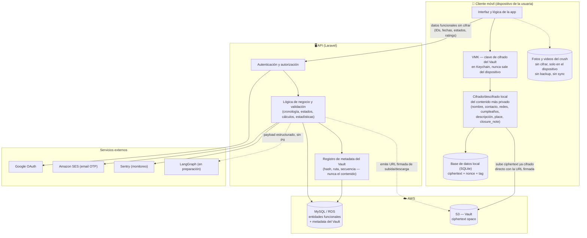

# Blueprint de Producto — MyDuckingLife (MDL)

> **Ámbito:** propuesta de valor, actores, casos de uso, modelo de datos, reglas de negocio, arquitectura funcional y seguridad de MDL, con el Vault E2EE completo.
> **Sistema:** aplicación móvil iOS/Android + API REST Laravel.
> **Fuera de alcance:** interpretación legal y estado de cumplimiento normativo — eso vive en `docs/legal/`.

---

## 1. Objetivo del Producto

**MyDuckingLife (MDL)** es una aplicación móvil privada que permite a los usuarios llevar un **diario personal y cifrado** de sus intereses románticos, experiencias compartidas y evolución de relaciones. Es una herramienta de **auto-reflexión y journaling** — no una red social.

### Propuesta de valor
- **Privacidad absoluta:** ningún dato es público, compartido ni visible para otros usuarios.
- **Estructura:** organiza romantic interests ("Crushes"), momentos vividos ("Experiences") y estados de relación en una cronología clara.
- **Insights personales:** estadísticas derivadas de los propios datos del usuario (patrones, conversiones, satisfacción).
- **Seguridad de extremo a extremo (Vault E2EE):** el nombre, contacto, redes y fecha de nacimiento del crush, el lugar y descripción de cada experiencia, y la nota de cierre de cada relación se cifran en el dispositivo del usuario con una clave que el servidor nunca recibe. El backend nunca ve ese contenido en texto plano, ni siquiera con acceso directo a la base de datos.
- **Datos de cuenta protegidos:** email y teléfono del usuario se cifran en reposo con la clave de aplicación; el resto de datos de cuenta y estructura funcional (fechas, estados, valoraciones) están protegidos por autorización estricta por propietario.
- **Anonimización en cascada** al eliminar cuenta y **auditoría inmutable** de operaciones sensibles.

### Audiencia
- **Usuarios finales:** personas adultas (18+) que desean un espacio privado para registrar y reflexionar sobre su vida romántica.
- **Sistemas externos:** AWS (S3, RDS), Google (OAuth), Sentry (monitoreo), proveedor de email (SES).

### Restricciones del negocio
- Aplicación exclusivamente B2C; sin funcionalidad multi-usuario ni social.
- Todo el contenido es propietario del usuario y se elimina a pedido.
- Edad mínima: 18 años (validación por fecha de nacimiento).
- Plan actual: solo gratuito (Plan 1). Infraestructura para planes pagos existe pero no está activa.
- No hay panel de administración ni rol de admin dentro de la aplicación; es 100% self-service.

---

## 2. Actores del Sistema

| Actor | Tipo | Descripción | Interacciones |
|-------|------|-------------|---------------|
| **Usuario Anónimo** | Humano | Persona sin autenticar en la app | Registro, login, recuperación de password, ver términos/privacidad |
| **Usuario Autenticado** | Humano | Usuario con sesión activa (Sanctum token) | Crear/editar crushes, experiencias, relaciones; subir media; ver estadísticas; editar perfil; borrar cuenta; completar tests |
| **Usuario Eliminado** | Humano (estado) | Cuenta anonimizada y soft-deleted | Sin funciones; datos sobrescritos con placeholders |
| **Sistema MDL (API)** | Sistema | Backend Laravel que orquesta lógica de negocio | Procesa requests, valida, persiste, encripta, dispara jobs |
| **Sistema MDL (Scheduler)** | Sistema | Procesos programados (Laravel Scheduler + Supervisor) | Purga de datos, pruning de tokens, pruning de registros temporales |
| **AWS S3** | Servicio externo | Almacenamiento de archivos multimedia | Recibe uploads, sirve objetos privados vía presigned URLs |
| **AWS RDS (MySQL)** | Servicio externo | Base de datos relacional | Persistencia de todas las entidades |
| **Google OAuth** | Servicio externo | Proveedor de identidad federada | Autenticación/registro de usuarios vía Google |
| **Amazon SES** | Servicio externo | Envío de emails transaccionales | Envío de OTP para recuperación de password |
| **Sentry** | Servicio externo | Error tracking y monitoreo | Recibe excepciones y alertas del sistema |
| **LangGraph / LLM** | Servicio externo, no activo | Motor de IA para interpretación de estadísticas | Recibirá payload enriquecido de estadísticas; la API no interactúa directamente, solo prepara el payload |

> No existe un actor "Administrador". La aplicación es 100% self-service. Cualquier operación (auditoría, soporte) requiere acceso directo a la base de datos o logs, no un panel de admin.

---

## 3. Casos de Uso

### 3.1 Casos de uso implementados

| ID | Caso de Uso | Actor | Descripción |
|----|-------------|-------|-------------|
| UC-01 | Registro de usuario | Usuario Anónimo | Crear cuenta con email, password, fecha de nacimiento, aceptación de términos y privacidad |
| UC-02 | Inicio de sesión | Usuario Anónimo | Autenticarse con email/password o Google OAuth; obtener token Sanctum |
| UC-03 | Recuperación de contraseña | Usuario Anónimo | Solicitar OTP por email, verificar código, establecer nueva contraseña |
| UC-04 | Cierre de sesión | Usuario Autenticado | Revocar token Sanctum actual |
| UC-05 | Ver perfil propio | Usuario Autenticado | Consultar datos personales, plan, flags de tutorial |
| UC-06 | Editar perfil | Usuario Autenticado | Modificar email, password, fecha de nacimiento, teléfono, género, país, plan |
| UC-07 | Crear crush | Usuario Autenticado | Registrar nueva persona de interés romántico con datos, atributos y ratings |
| UC-08 | Editar crush | Usuario Autenticado | Modificar datos de un crush existente, incluyendo `met_at` y fechas sincronizadas |
| UC-09 | Eliminar crush | Usuario Autenticado | Soft-delete de crush y cascada a experiencias, relaciones y media asociados |
| UC-10 | Ver lista de crushes | Usuario Autenticado | Listar crushes con paginación, filtros y estado derivado |
| UC-11 | Ver detalle de crush | Usuario Autenticado | Consultar todos los datos de un crush incluyendo relaciones y experiencias |
| UC-12 | Crear experiencia | Usuario Autenticado | Registrar un momento compartido con un crush (fecha, lugar, descripción, satisfacción) |
| UC-13 | Editar experiencia | Usuario Autenticado | Modificar datos de una experiencia existente |
| UC-14 | Eliminar experiencia | Usuario Autenticado | Soft-delete de experiencia |
| UC-15 | Crear relación | Usuario Autenticado | Registrar un nuevo estado de relación con un crush (cierra la anterior automáticamente) |
| UC-16 | Editar relación | Usuario Autenticado | Modificar estado o fecha de la relación más reciente (latest-only) |
| UC-17 | Eliminar relación | Usuario Autenticado | Eliminar relación más reciente (reabre la anterior automáticamente) |
| UC-18 | Subir media | Usuario Autenticado | Subir fotos o videos a un crush o experiencia |
| UC-19 | Ver media | Usuario Autenticado | Listar y visualizar fotos/videos de un crush o experiencia (vía presigned URLs) |
| UC-20 | Eliminar media | Usuario Autenticado | Eliminar foto o video (soft-delete + eliminación S3) |
| UC-21 | Ver timeline | Usuario Autenticado | Consultar feed cronológico de eventos del usuario |
| UC-22 | Ver estadísticas | Usuario Autenticado | Consultar métricas analíticas derivadas de sus datos |
| UC-23 | Eliminar cuenta | Usuario Autenticado | Solicitar eliminación de cuenta; el sistema anonimiza todos los datos |
| UC-24 | Aceptar términos/privacidad | Usuario Autenticado | Registrar aceptación de una versión específica de términos o política de privacidad |
| UC-25 | Marcar tutorial completado | Usuario Autenticado | Actualizar flags de tutorial vistos |
| UC-26 | Configurar el Vault E2EE | Usuario Autenticado | Generar VMK, encapsularla con contraseña/frase de 24 palabras y confirmar el alta del Vault |
| UC-27 | Desbloquear el Vault | Usuario Autenticado | Autenticar localmente (biometría/Keychain) para descifrar contenido privado en el dispositivo |
| UC-28 | Recuperar el Vault en un dispositivo nuevo | Usuario Autenticado | Reconstruir la VMK mediante contraseña, frase de 24 palabras o transferencia QR, y sincronizar todas las entradas |
| UC-29 | Gestionar dispositivos y recovery keys del Vault | Usuario Autenticado | Listar, autorizar o revocar dispositivos y rotar la clave de recuperación |

### 3.2 Casos de uso no implementados

| ID | Caso de Uso | Actor | Descripción | Estado |
|----|-------------|-------|-------------|--------|
| UC-30 | Realizar test de estilo de apego | Usuario Autenticado | Responder cuestionario de attachment style y obtener resultado | Infraestructura existe, no activo |
| UC-31 | Realizar test de personalidad | Usuario Autenticado | Responder cuestionario de personalidad y obtener resultado | Infraestructura existe, no activo |
| UC-32 | Recibir notificaciones push | Usuario Autenticado | Recibir alertas push en el dispositivo | Placeholder, no activo |
| UC-33 | Exportar datos personales | Usuario Autenticado | Descargar todos sus datos en formato portable (GDPR) | No implementado |
| UC-34 | Cambiar plan de suscripción | Usuario Autenticado | Elegir plan de pago con límites y funciones diferenciadas | Infraestructura existe, no activo |
| UC-35 | Ver insights con IA | Usuario Autenticado | Recibir interpretación narrativa de sus estadísticas generada por IA | En preparación (AI Payload) |

---

## 4. Capturas de Pantalla / Mockups

Este documento es una especificación funcional y arquitectónica. No incluye capturas de pantalla, mockups ni diseños de UI porque el sistema se consume a través de una API REST y la interfaz visual es responsabilidad de la aplicación móvil (iOS/Android). Las especificaciones de campos visibles, validaciones de formularios y reglas de negocio por pantalla están documentadas en las secciones de **Casos de Uso** y **Reglas de Negocio**.

Un documento de diseño de UI/UX con wireframes o mockups es producido por el equipo de diseño de producto de la app móvil y queda fuera del alcance de este blueprint.

---

## 5. Diccionario de Datos

### 5.1 Entidades principales (maestros transaccionales)

| Entidad | Descripción | Campos clave | Volatilidad |
|---------|-------------|-------------|-------------|
| **User** | Usuario registrado de la aplicación | id (UUID), email (encrypted), password_hash, phone (encrypted), birth_date, age, country_id, gender_id, plan_id, google_id, last_login, is_tutorial_done, is_profile_tutorial_done, deleted_at | Media |
| **Crush** | Persona de interés romántico | id (UUID), user_id, age, age_as_of, gender_id, country_id, ducky_id, current_state_id, match_status_id, rate_beauty, rate_emotional_connection, rate_personality, rate_sex_appeal, rate_global, met_at, zodiac_id, height_id, eye_color_id, hair_color_id, body_type_id, skin_color_id, correlation_id, is_archived, is_anonymized, last_activity_at, last_user_edit_at, deleted_at | Alta |
| **Experience** | Momento o evento compartido con un crush | id (UUID), user_id, crush_id, satisfaction_id, date, correlation_id, deleted_at | Alta |
| **Relationship** | Estado de una relación en un momento del tiempo | id (UUID), user_id, crush_id, state_id, match_status_id, start_date, end_date, experience_id, correlation_id, deleted_at | Alta |
| **File** | Archivo multimedia (foto o video) — entidad existente pero **sin uso real hoy**: la galería del crush guarda fotos y videos solo en el dispositivo y nunca crea un registro `File` ni sube nada a S3. Ver 9.5. | id, user_id, crush_id, experience_id, aws_url, local_path, mime_type, type, original_name, cover, size, deleted_at | Ninguna (sin escrituras desde el flujo activo) |
| **Vault** | Contenedor criptográfico E2EE de una cuenta | id, user_id, crypto_version, status | Baja |
| **VaultEncapsulation** | Envoltorio de la VMK (por contraseña y por frase mnemónica) | vault_id, kdf_params, salt, ciphertext, nonce, tag | Baja |
| **VaultBlob** | Objeto cifrado subido por el usuario (entrada de crush, experiencia o relación) | id, vault_id, owner_id, blob_type, length, hash, storage_path, crypto_version, nonce, tag, sequence, deleted_at | Alta |
| **VaultDevice** | Dispositivo autorizado a operar el Vault | id, vault_id, public_key_hash, authorized_at, last_used_at, revoked_at | Media |
| **VaultRecoveryKey** | VMK de respaldo encapsulada para recuperación | id, vault_id, fingerprint, created_at, revoked_at | Baja |
| **ActivityEvent** | Evento de timeline (feed de actividad) | id, user_id, entity_type, entity_id, event_type, metadata, created_at | Baja (inmutable) |
| **AuditEvent** | Registro de auditoría forense | id, user_id, target_type, target_id, event_type, trace_id, ip_address, user_agent, created_at | Baja (inmutable) |
| **SecurityAlert** | Alerta de comportamiento sospechoso | id, user_id, ip_address, threshold, window, created_at | Baja |
| **AccountDeletionFeedback** | Feedback de eliminación de cuenta | id, user_id, reason_id, reason_text, status, created_at | Baja |

`name`, `profession`, los contactos (`email`, `whatsapp_prefix`, `whatsapp_number`, `instagram`, `facebook`, `snapchat`, `tiktok`) y el día/mes de cumpleaños de **Crush**, así como `description`/`place` de **Experience** y `closure_note` de **Relationship**, no tienen columna funcional: viven exclusivamente como `VaultBlob` cifrado. Ver sección 5.3.

### 5.2 Entidades de referencia (lookups / maestros de datos)

| Entidad | Descripción | Fuente | Ejemplos |
|---------|-------------|--------|----------|
| **Gender** | Género | Tabla maestra propia | Masculino, Femenino, Otro |
| **Country** | País | Tabla maestra propia | Argentina, España, México... |
| **Ducky** | Categoría personal del usuario para un crush | Tabla maestra propia | 4 valores personalizados |
| **Zodiac** | Signo zodiacal | Derivado en el dispositivo a partir del día/mes de cumpleaños del Vault | Aries, Tauro... |
| **Height** | Rango de altura | Tabla maestra propia | Alto, Medio, Bajo |
| **EyeColor** | Color de ojos | Tabla maestra propia | Azul, Marrón, Verde... |
| **HairColor** | Color de cabello | Tabla maestra propia | Rubio, Castaño, Negro... |
| **BodyType** | Tipo de cuerpo | Tabla maestra propia | Delgado, Atlético... |
| **SkinColor** | Color de piel | Tabla maestra propia | Claro, Moreno, Oscuro... |
| **Satisfaction** | Nivel de satisfacción | Tabla maestra propia | 1 (muy negativo) a 5 (muy positivo) |
| **RelationshipState** | Estado de relación | Tabla maestra propia | PROSPECT, FLIRT, ONS, FWB, RELATIONSHIP, REJECTED, MISSED, ENDED |
| **MatchStatus** | Estado de match derivado | Derivado de state | YES (1), UNKNOWN (2), NO (3) |
| **Plan** | Plan de suscripción | Tabla maestra propia | 1 = Free (único activo) |
| **Term** | Términos de servicio | Tabla maestra propia | Contenido versionado de términos |
| **PrivacyPolicy** | Política de privacidad | Tabla maestra propia | Contenido versionado de política |
| **AccountDeletionReason** | Motivos de eliminación de cuenta | Tabla maestra propia | Lista de razones predefinidas |
| **HackTip** | Consejos románticos para el home feed | Tabla maestra propia | Tips generalizados |

### 5.3 Campos con datos personales (PII) y protección

| Entidad | Campo PII | Método de protección |
|---------|-----------|---------------------|
| **User** | email | Cifrado en reposo (AES-256-CBC vía Laravel Crypt, clave de aplicación) |
| **User** | phone | Cifrado en reposo (clave de aplicación) |
| **Crush** | name | **Vault E2EE.** Cifrado en el dispositivo con AES-256-GCM bajo la VMK del usuario antes de salir de iOS. El backend solo recibe y almacena ciphertext opaco; no existe una columna funcional legible con este valor. |
| **Crush** | profession, email, whatsapp_prefix, whatsapp_number, instagram, facebook, snapchat, tiktok | **Vault E2EE.** Igual que `name`: cifrados en el dispositivo, el backend nunca los recibe en claro. |
| **Crush** | birthdate (día/mes) | **Vault E2EE.** El backend solo conoce `age` y `age_as_of` (edad confirmada y su ancla temporal) y el `zodiac_id` ya derivado; nunca el día ni el mes exactos. |
| **Experience** | description, place | **Vault E2EE.** Cifrados en el dispositivo bajo la VMK; el backend almacena únicamente ciphertext y metadata (fecha, satisfacción, asociación). |
| **Relationship** | closure_note | **Vault E2EE.** Cifrado en el dispositivo bajo la VMK; el backend almacena únicamente ciphertext y metadata (estado, fechas, asociación). |
| **VaultEncapsulation** | VMK encapsulada | La VMK de 32 bytes se deriva/encapsula con Argon2id (contraseña, frase de 24 palabras o QR); el backend nunca recibe la VMK en claro y no puede descifrar un `VaultBlob`. |

El contenido de `Crush`, `Experience` y `Relationship` listado arriba vive exclusivamente como `VaultBlob` cifrado con la VMK del usuario. Los endpoints funcionales de creación y edición de estas entidades transportan únicamente IDs, fechas, estados, valoraciones y clasificaciones — nunca estos campos. Los datos de cuenta (`User.email`, `User.phone`) siguen protegidos con la clave de aplicación porque no forman parte del alcance del Vault.

---

## 6. Matriz de Datos (CRUD por Entidad y Actor)

| Entidad | Usuario Anónimo | Usuario Autenticado | Sistema (Scheduler) | Sistema (API Interna) |
|---------|----------------|---------------------|---------------------|----------------------|
| **User** | C (registro) | RU (perfil propio) | — | U (anonimización), D (soft-delete) |
| **Crush** | — | CRUD | — | U (anonimización), D (soft-delete cascada) |
| **Experience** | — | CRUD | — | U (anonimización), D (soft-delete cascada) |
| **Relationship** | — | CRUD | — | U (anonimización), D (soft-delete cascada) |
| **File** | — | *(endpoint existe pero no se usa: la galería del crush no lo llama)* | — | — |
| **Vault / VaultEncapsulation** | — | C (init), R (show), U (rotar encapsulación) | — | D (baja de cuenta) |
| **VaultBlob** | — | CRUD (vía cola de sincronización cifrada) | D (purga 7 días tras soft delete) | — |
| **VaultDevice** | — | CR, D (revocar) | — | — |
| **VaultRecoveryKey** | — | CR, D (revocar/rotar) | — | — |
| **ActivityEvent** | — | R (timeline) | D (purga 7 días) | — |
| **AuditEvent** | — | — | D (purga 90 días) | C (toda operación sensible) |
| **SecurityAlert** | — | — | D (purga 30 días) | C (detección automática) |
| **AccountDeletionFeedback** | — | C (al eliminar cuenta) | — | U (actualización por job) |
| **UserTermsAcceptance** | — | C (aceptación) | — | — |
| **UserPrivacyPolicyAcceptance** | — | C (aceptación) | — | — |
| **PasswordOtp** | R (verificación) | — | D (purga post-expiry) | C (generación) |
| **Gender / Country / Ducky / etc.** | R (lookups) | R (lookups) | — | — |

**Leyenda:** C = Create, R = Read, U = Update, D = Delete

---

## 7. Datos de Terceros y Su Tratamiento

### 7.1 Google OAuth (Autenticación federada)

| Aspecto | Detalle |
|---------|---------|
| **Proveedor** | Google LLC |
| **Datos recibidos** | email, google_id, nombre (opcional) |
| **Finalidad** | Autenticación y registro de usuario sin password |
| **Base legal** | Consentimiento del usuario (clic en "Continuar con Google") |
| **Tratamiento** | El email se almacena cifrado; el google_id se almacena en texto plano como identificador federado |
| **Compartición** | Ningún dato de MDL se envía a Google |
| **Retención** | Datos de Google se mantienen mientras el usuario mantenga la cuenta activa |
| **Eliminación** | Al anonimizar la cuenta, el google_id se conserva o se nulifica según decisión de negocio vigente |

### 7.2 Amazon S3 (Almacenamiento de media)

| Aspecto | Detalle |
|---------|---------|
| **Proveedor** | Amazon Web Services (AWS) |
| **Datos almacenados** | Fotos y videos subidos por los usuarios |
| **Finalidad** | Backup y recuperación de media; visualización en la app |
| **Base legal** | Ejecución del contrato (servicio de almacenamiento) |
| **Tratamiento** | Todos los objetos son **privados** (`visibility: private`). No son accesibles públicamente. Las URLs son presigned de corta duración. |
| **Encriptación** | En tránsito: TLS. En reposo: SSE-S3 (encriptación gestionada por AWS) |
| **Retención** | Hasta que el usuario elimine el archivo o elimine la cuenta |
| **Eliminación** | Soft-delete del registro File + eliminación del objeto S3 (async vía job) |
| **Region** | eu-west-1 (Irlanda) |

### 7.3 Amazon RDS (Base de datos MySQL)

| Aspecto | Detalle |
|---------|---------|
| **Proveedor** | Amazon Web Services (AWS) |
| **Datos almacenados** | Datos funcionales de la aplicación (usuarios, estructura de crushes, experiencias, relaciones, media) y metadata/encapsulaciones del Vault |
| **Finalidad** | Persistencia transaccional de datos |
| **Encriptación** | En tránsito: TLS. En reposo: campos PII de cuenta cifrados por aplicación (AES-256-CBC); cifrado de storage RDS opcional |
| **Backups** | Automáticos por AWS RDS (configuración operativa) |
| **Region** | eu-west-1 |

### 7.4 Amazon SES (Email transaccional)

| Aspecto | Detalle |
|---------|---------|
| **Proveedor** | Amazon Web Services (AWS) |
| **Datos enviados** | Email del usuario (solo para envío de OTP) |
| **Finalidad** | Envío de código de verificación para recuperación de contraseña |
| **Tratamiento** | El email se envía a SES para delivery; SES no almacena el contenido de forma persistente |
| **Retención** | Logs de envío por SES según política de AWS |

### 7.5 Sentry (Monitoreo de errores)

| Aspecto | Detalle |
|---------|---------|
| **Proveedor** | Functional Software, Inc. (Sentry) |
| **Datos enviados** | Stack traces, trace_id, user_id (contexto de error), excepciones |
| **Finalidad** | Detección y diagnóstico de errores en producción |
| **Tratamiento** | Datos de contexto no incluyen contenido del Vault ni PII cifrada; solo identificadores de usuario y metadatos de request |
| **Base legal** | Interés legítimo (estabilidad del sistema) |

### 7.6 Kingfisher (Cliente iOS)

| Aspecto | Detalle |
|---------|---------|
| **Proveedor** | Open source (ONEvao) |
| **Datos procesados** | Imágenes descargadas de S3 |
| **Finalidad** | Caché local de imágenes en el dispositivo del usuario |
| **Tratamiento** | La librería almacena temporalmente en disco y RAM del dispositivo. No envía datos a terceros. |
| **Retención** | Caché temporal; el sistema operativo puede limpiarla por falta de espacio |

---

## 8. Cuestionarios (Tests de Personalidad)

### 8.1 Test de Estilo de Apego (Attachment Style Test)

**Estado:** Infraestructura existente en el código, no activo para usuarios finales. El scoring está simulado (mock) en el controlador; no hay lógica real de cálculo implementada.

**Descripción:** Cuestionario de autodiagnóstico que evalúa el estilo de apego del usuario (Secure, Anxious, Avoidant) basado en sus respuestas a una serie de preguntas.

**Flujo:**
1. El usuario accede a la sección de tests de personalidad.
2. El sistema devuelve las preguntas del test desde `config/personality_tests.php`.
3. El usuario responde paso a paso; el sistema guarda progreso en `user_test_progress`.
4. Al completar, el sistema calcula puntuación por dimensión (Secure, Anxious, Avoidant).
5. El sistema devuelve el estilo dominante y la explicación.

**Datos técnicos:**
- **Tablas:** `user_test_progress` (sesión activa), `user_test_results` (resultado final)
- **Formato de respuestas:** JSON en columna `answers`
- **Versión:** `v1` (permite futuras versiones sin invalidar resultados previos)
- **Scoring:** Simple y determinista, sin pretensión clínica. Suma de puntos por dimensión.

**Modelo de resultado:**
```
{
  "dominant_style": "secure",
  "scores": { "secure": 4, "anxious": 2, "avoidant": 1 }
}
```

### 8.2 Tests de Personalidad (Personality Tests)

**Estado:** Infraestructura existente, no activo. Endpoints mapeados pero no expuestos en la app; scoring no implementado; tests no disponibles para el usuario.

**Descripción:** Framework genérico para cuestionarios de personalidad. Actualmente solo el attachment style está configurado, pero la estructura permite agregar más tipos de test (compatibility, love languages, etc.).

**Rutas existentes:**
- `GET /personality-tests/{test_type}` — Obtener preguntas
- `POST /personality-tests/{test_type}/responses` — Enviar respuesta
- `GET /personality-tests/{test_type}/resume` — Reanudar progreso
- `GET /personality-tests/{test_type}/result` — Ver resultado

---

## 9. Reglas de Negocio (Business Rules)

### 9.1 Reglas de autenticación y usuario

| ID | Regla | Severidad |
|----|-------|-----------|
| BR-01 | El usuario debe tener al menos 18 años para registrarse | Obligatoria |
| BR-02 | La contraseña debe tener mínimo 8 caracteres, incluyendo mayúscula, minúscula, dígito y carácter especial | Obligatoria |
| BR-03 | El email debe ser único en el sistema (case-insensitive) | Obligatoria |
| BR-04 | La respuesta de "forgot password" debe ser idéntica si el email existe o no (anti-enumeración) | Obligatoria |
| BR-05 | El OTP de recuperación expira tras un período configurado | Obligatoria |
| BR-06 | Los tokens Sanctum expiran tras 30 días de inactividad | Obligatoria |
| BR-07 | El usuario debe aceptar los términos y la política de privacidad vigentes para registrarse | Obligatoria |
| BR-08 | La fecha de nacimiento actualiza automáticamente el campo `age` | Automática |

### 9.2 Reglas de crush

| ID | Regla | Severidad |
|----|-------|-----------|
| BR-10 | El nombre del crush no puede estar vacío ni ser solo espacios | Obligatoria |
| BR-11 | El crush debe tener género, país y ducky válidos | Obligatoria |
| BR-12 | La fecha `met_at` no puede ser posterior a ninguna fecha de experiencia o relación existente | Obligatoria |
| BR-13 | Al actualizar `met_at`, se sincroniza automáticamente la primera relación y primera experiencia del bundle | Obligatoria |
| BR-14 | El día y mes de cumpleaños son opcionales y viven exclusivamente en el Vault; el `zodiac_id` se deriva en el dispositivo a partir de esos valores y se envía a la API ya calculado | Automática |
| BR-16 | El `rate_global` es el promedio aritmético de los 4 ratings (beauty, emotional, personality, sex_appeal) | Automática |
| BR-17 | El campo `is_anonymized` oculta el crush de todas las consultas estándar (AnonymizedScope) | Obligatoria |
| BR-18 | Un crush eliminado (soft-delete) en cascada elimina sus experiencias, relaciones y archivos | Automática |
| BR-19 | La cantidad de fotos por crush está limitada por el plan del usuario | Obligatoria |

### 9.3 Reglas de experiencia

| ID | Regla | Severidad |
|----|-------|-----------|
| BR-20 | La fecha de la experiencia debe ser mayor o igual que `crush.met_at` | Obligatoria |
| BR-21 | No se permite duplicar experiencias en la misma fecha para el mismo crush | Obligatoria |
| BR-22 | Los campos `description` y `place` se cifran en el dispositivo (Vault E2EE) antes de salir de iOS; el backend nunca los recibe en claro ni los persiste en una columna funcional | Obligatoria |
| BR-23 | El `place` se normaliza en minúsculas antes de cifrarse | Automática |
| BR-24 | La satisfacción debe estar entre 1 y 5 | Obligatoria |

### 9.4 Reglas de relación (máquina de estados)

| ID | Regla | Severidad |
|----|-------|-----------|
| BR-30 | Solo una relación activa (`end_date = null`) por crush a la vez | Obligatoria |
| BR-31 | Al crear una nueva relación, se cierra automáticamente la activa anterior (`end_date = start_date` de la nueva) | Obligatoria |
| BR-32 | Solo se puede editar o eliminar la relación más reciente (latest-only) | Obligatoria |
| BR-33 | Al eliminar la relación más reciente, se reabre la inmediatamente anterior | Obligatoria |
| BR-34 | La fecha de inicio de la primera relación debe ser igual a `crush.met_at` | Obligatoria |
| BR-35 | El `match_status_id` se deriva del estado de la relación más reciente | Automática |
| BR-36 | El `match_status` es monotónico: una vez YES, nunca vuelve a UNKNOWN o NO | Obligatoria |
| BR-37 | Las transiciones de estado deben respetar la matriz de transiciones permitidas | Obligatoria |
| BR-38 | Se usa `lockForUpdate` (pessimistic locking) sobre el crush al modificar relaciones | Obligatoria |
| BR-39 | La fecha de inicio de una nueva relación no puede ser anterior a `crush.met_at` | Obligatoria |
| BR-40 | No se permite insertar una relación en medio de una cronología existente | Obligatoria |

### 9.5 Reglas de media

> **Estado actual:** la galería del crush guarda fotos y videos únicamente en el dispositivo (`Documents/LocalMedia/{crushId}`). No hay backup ni sincronización remota — es una exclusión deliberada del alcance del Vault, documentada en `product/docs/plans/completed/photo-backup-hold/README.md` y en `product/docs/plans/active/vault-e2ee/README.md`, no una integración a medio construir. BR-50 a BR-56 describen un almacenamiento en S3 que existe como endpoint genérico pero que la galería del crush **no usa hoy**; se conservan documentadas para cuando se retome esa decisión.

| ID | Regla | Estado hoy | Severidad |
|----|-------|-----------|-----------|
| BR-50 | Los tipos MIME aceptados son: image/jpeg, image/png, image/webp, image/gif, image/heic, image/heif, image/avif, video/mp4, video/quicktime | No conectado a la galería del crush | Obligatoria |
| BR-51 | El tamaño máximo por archivo es de 20MB | No conectado a la galería del crush | Obligatoria |
| BR-52 | Se almacena el original en S3 (path `backups/`) y se intenta crear una versión optimizada (path `public/`) | No conectado a la galería del crush | Obligatoria |
| BR-53 | Si la optimización falla, solo se mantiene el original (graceful degradation) | No conectado a la galería del crush | Obligatoria |
| BR-54 | Los objetos S3 son siempre privados; se acceden vía presigned URLs de corta duración | No conectado a la galería del crush | Obligatoria |
| BR-55 | Los videos se almacenan sin procesamiento (passthrough) | No conectado a la galería del crush | Obligatoria |
| BR-56 | Al eliminar media, se realiza soft-delete del registro y eliminación del objeto S3 | No conectado a la galería del crush | Obligatoria |
| BR-57 | Los campos EXIF (incluyendo GPS) se eliminan de las imágenes antes de guardarlas localmente | **Activa** | Privacidad |
| BR-58 | Las fotos del crush quedan excluidas del backup general del sistema operativo del dispositivo (`NSURLIsExcludedFromBackupKey`) | **No implementada todavía** | Privacidad |
| BR-59 | Al eliminar un crush, su carpeta local de fotos se elimina junto con la entidad; no queda huérfana en el dispositivo | **No implementada todavía** | Obligatoria |

### 9.6 Reglas de anonimización y eliminación

| ID | Regla | Severidad |
|----|-------|-----------|
| BR-60 | La anonimización es irreversible; los datos originales no pueden recuperarse | Obligatoria |
| BR-61 | El email se reemplaza por `deleted_{id}@anon.anon` | Obligatoria |
| BR-62 | El nombre del crush se reemplaza por `ANON_{random}` | Obligatoria |
| BR-63 | Todos los campos PII se sobrescriben con placeholders | Obligatoria |
| BR-64 | Los registros anonimizados se preservan para estadísticas agregadas (no contienen PII) | Obligatoria |
| BR-65 | El soft-delete del usuario se ejecuta tras la anonimización | Obligatoria |
| BR-66 | Los tokens Sanctum se revocan inmediatamente | Obligatoria |
| BR-67 | La eliminación de archivos S3 es async vía job con reintentos (máximo 3) | Obligatoria |
| BR-68 | Los ActivityEvents del usuario se eliminan en cascada al anonimizar | Obligatoria |
| BR-69 | La anonimización de cada crush está protegida por try/catch; fallo de un crush no interrumpe los demás | Obligatoria |

### 9.7 Reglas de auditoría y seguridad

| ID | Regla | Severidad |
|----|-------|-----------|
| BR-70 | Los AuditEvents son inmutables: nunca se modifican ni eliminan por flujos de usuario | Obligatoria |
| BR-71 | Los AuditEvents se retienen por 90 días | Obligatoria |
| BR-72 | Los ActivityEvents se retienen por 7 días | Obligatoria |
| BR-73 | Los SecurityAlerts se retienen por 30 días | Obligatoria |
| BR-74 | El rate limiting se aplica por ruta y por usuario/IP | Obligatoria |
| BR-75 | La detección de comportamiento sospechoso solo opera en entornos no-local | Obligatoria |
| BR-76 | El email nunca se loguea en texto plano; se usa hash truncado si es necesario | Obligatoria |
| BR-77 | Las respuestas de error no exponen detalles internos del sistema (stack traces, queries) | Obligatoria |

### 9.8 Reglas de estadísticas

| ID | Regla | Severidad |
|----|-------|-----------|
| BR-80 | Las estadísticas solo incluyen datos del usuario autenticado | Obligatoria |
| BR-81 | Los registros soft-deleted o anonimizados no se incluyen en estadísticas | Obligatoria |
| BR-82 | Las estadísticas se calculan on-demand (no pre-calculadas) | Automática |
| BR-83 | Todos los valores numéricos se redondean a 2 decimales | Automática |
| BR-84 | La escala de satisfacción es siempre 1..5 (no -2..2) | Obligatoria |
| BR-85 | El payload de IA debe declarar `unit`, `scale_ref`, `meaning` y `reliability` por métrica | Obligatoria |
| BR-86 | Las señales derivadas (`derived_signals`) con `reliability: very_low` no se emiten | Obligatoria |
| BR-87 | La API nunca genera prosa, interpretación causal ni consejo; solo datos y cruces numéricos | Obligatoria |

### 9.9 Reglas del Vault E2EE

| ID | Regla | Severidad |
|----|-------|-----------|
| BR-90 | Cada crush, experiencia y relación tiene una entrada Vault propia, identificada por tipo + ID funcional; nunca comparten entrada | Obligatoria |
| BR-91 | La VMK se genera en el dispositivo, se guarda en Keychain (`WhenUnlockedThisDeviceOnly` + biometría) y nunca se envía al backend en claro | Obligatoria |
| BR-92 | El backend no ofrece ninguna operación que descifre un `VaultBlob`; solo autoriza, almacena y entrega ciphertext | Obligatoria |
| BR-93 | Contraseña de recuperación, frase de 24 palabras y transferencia QR reconstruyen la misma VMK y el mismo conjunto de entidades en un dispositivo limpio | Obligatoria |
| BR-94 | Una recuperación o validación de Vault nunca ejecuta borrados remotos; varias experiencias o relaciones de un mismo crush se recuperan todas, sin colisionar entre sí | Obligatoria |
| BR-95 | Una nueva versión de un `VaultBlob` se confirma como subida antes de retirar la versión anterior; un fallo deja la operación reintentable sin pérdida de datos | Obligatoria |
| BR-96 | La búsqueda local por nombre se resuelve en memoria sobre contenido ya descifrado; no existe un índice persistente en texto plano ni el término de búsqueda se envía al backend | Obligatoria |
| BR-97 | Ningún log, request funcional, reporte de error o analítica contiene contenido descifrado del Vault | Obligatoria |
| BR-98 | Al borrar un crush, se borran en la misma operación sus `VaultBlob` remotos, sus entradas locales y su carpeta de fotos | Obligatoria |

---

## 10. Inteligencia Artificial (IA)

### 10.1 Alcance de IA en MyDuckingLife

**Estado:** En preparación. No hay modelo de IA entrenado por MDL ni procesamiento de IA en el backend. La API prepara un **payload estructurado** que será consumido por un motor externo (LangGraph) para generar interpretaciones narrativas de las estadísticas del usuario.

### 10.2 Filosofía de IA en MDL

| Principio | Descripción |
|-----------|-------------|
| **La API nunca genera prosa** | El backend solo entrega datos, escalas, cruces numéricos y límites. Nunca redacta interpretaciones, consejos ni narrativas. |
| **LangGraph = redactor; API = fuente de verdad** | El motor de IA (externo) recibe el payload estructurado y redacta dentro de los límites que la API marca. |
| **No hay entrenamiento con datos de usuario** | No se utilizan datos de usuario para entrenar modelos de IA. Los datos solo se procesan para generar estadísticas agregadas. |
| **Cruces con criterio cerrado** | La API resuelve los cruces de datos con reglas explícitas para que el LLM alucine menos. |
| **Forbidden claims** | El payload incluye afirmaciones prohibidas que el LLM no debe hacer (ej. causalidad, diagnóstico, juicio de valor). |

### 10.3 Entradas del sistema de IA

| Entrada | Origen | Descripción |
|---------|--------|-------------|
| Estadísticas del usuario | Statistics context | Métricas calculadas a partir de crushes, experiencias y relaciones |
| Metadata semántica | StatisticsMetricCatalog | Unidad, escala, significado de cada métrica |
| Señales derivadas | StatisticsCrossCatalog | 16 cruces de datos con evidencia, fuerza, polaridad y afirmaciones permitidas/prohibidas |
| Contexto de usuario | Meta bloque | Días de historia, totales de crushes, experiencias, relaciones |
| Calidad de datos | DataQualityWarnings | Avisos sobre muestra pequeña, datos dispersos, etc. |
| Instrucciones para LLM | LlMInstructions | Reglas de razonamiento, scope, dominio, forbidden claims globales |

### 10.4 Gestión y salidas

| Salida | Descripción | Destino |
|--------|-------------|---------|
| **AI Payload** | JSON estructurado con métricas, señales, contexto e instrucciones | LangGraph (proyecto externo) |
| **Estadísticas enriquecidas** | Respuestas de endpoints de estadísticas con metadata semántica | App móvil |

### 10.5 Restricciones y límites

| Restricción | Descripción |
|-------------|-------------|
| **No diagnóstico** | El sistema nunca diagnostica, prescribe ni ofrece consejo terapéutico. |
| **No causalidad** | Los cruces de datos muestran asociación, no causalidad. |
| **No juicio de valor** | El sistema no juzga al usuario por sus datos. |
| **Muestra insuficiente** | Métricas con menos de 3 registros se marcan como `reliability: very_low` y no se emiten señales derivadas. |
| **Privacidad** | El payload no incluye PII ni datos identificables del usuario. |

### 10.6 Entrenamiento

MyDuckingLife no entrena modelos de IA propios. No se recolectan datos de usuario para fine-tuning ni se envían datos a servicios de entrenamiento de terceros. El único procesamiento de IA es la preparación de un payload estructurado para consumo de un LLM externo controlado por el equipo de producto.

---

## 11. Estadísticas

### 11.1 Estadísticas disponibles para el usuario

| Estadística | Descripción | Tipo |
|-------------|-------------|------|
| **Overview** | Totales: crushes, experiencias, relaciones, días activos | Resumen |
| **Average time between statuses** | Días promedio entre cambios de estado de relación | Métrica |
| **Average satisfaction (crushes)** | Rating global promedio de crushes | Métrica |
| **Average satisfaction (experiences)** | Satisfacción promedio de experiencias | Métrica |
| **Crush rating details** | Desglose de ratings por dimensión (beauty, emotional, personality, sex appeal) | Distribución |
| **Zodiac crush distribution** | Distribución de crushes por signo zodiacal | Distribución |
| **Top crush countries** | Países con más crushes registrados | Distribución |
| **Top adjective traits** | Adjetivos de personalidad más frecuentes | Distribución |
| **Top physical traits** | Rasgos físicos más frecuentes | Distribución |
| **Crush conversion rates** | Distribución de match status (YES/UNKNOWN/NO) | Distribución |
| **Common traits in wins** | Rasgos comunes en crushes con match status YES | Cruzado |

### 11.2 Métricas de calidad por estadística

| Atributo | Descripción |
|----------|-------------|
| `value` | Valor numérico de la métrica |
| `unit` | Unidad de medida (percentage, days, count, ratio, distribution) |
| `scale_ref` | Referencia de escala (1..5, 0..100, etc.) |
| `meaning` | Significado semántico de la métrica (en inglés, key-based) |
| `windows` | Valores por ventana temporal (quarter, semester, year, lifetime) |
| `coverage` | Porcentaje de datos disponibles (0..1) |
| `reliability` | Confiabilidad basada en tamaño de muestra (high, medium, low, very_low) |
| `reason_codes` | Códigos explicativos de la confiabilidad |

### 11.3 Señales derivadas (derived_signals)

**Catálogo de 16 cruces** que identifican patrones en los datos del usuario. Cada señal incluye:
- `evidence_metrics`: métricas que la sustentan
- `computed`: valores calculados (ej. delta entre dos métricas)
- `strength`: fuerza de la señal
- `reliability`: confiabilidad basada en muestra
- `polarity`: tipo de señal (strength, weakness, pattern, anomaly)
- `allowed_interpretations`: interpretaciones permitidas para el LLM
- `forbidden_claims`: afirmaciones que el LLM no debe hacer

**Ejemplo de señal:**
- `connection_drives_success`: La conexión emocional parece asociada con resultados positivos.
- Forbidden claim: "La conexión emocional CAUSA el éxito" (no se puede afirmar causalidad).

---

## 12. Inferencias (Datos Derivados)

### 12.1 Campos calculados automáticamente

| Campo | Entidad | Fórmula / Regla de derivación | Origen |
|-------|---------|-------------------------------|--------|
| **age** | User | Calculado a partir de `birth_date` | Automático |
| **zodiac_id** | Crush | Derivado en el dispositivo a partir del día/mes de cumpleaños guardado en el Vault; la API solo almacena el valor ya calculado | Derivado (cliente) |
| **rate_global** | Crush | Promedio aritmético de los 4 ratings (beauty, emotional, personality, sex_appeal) | Automático |
| **current_state_id** | Crush | `state_id` de la relación activa más reciente (end_date = null) | Derivado |
| **match_status_id** | Crush | Derivado de `current_state_id` via MatchStatusDeriver: PROSPECT/FLIRT→UNKNOWN, ONS/FWB/RELATIONSHIP/ENDED→YES, REJECTED/MISSED→NO | Derivado |
| **match_status monotónico** | Crush | Una vez YES, nunca baja a UNKNOWN o NO | Regla de negocio |

### 12.2 Lógica de derivación de Match Status

| Estado de relación (state_id) | Match Status (match_status_id) |
|-------------------------------|-------------------------------|
| PROSPECT (1) | UNKNOWN (2) |
| FLIRT (2) | UNKNOWN (2) |
| ONE_NIGHT_STAND (3) | YES (1) |
| FWB (4) | YES (1) |
| RELATIONSHIP (5) | YES (1) |
| ENDED (8) | YES (1) — preserva status anterior |
| REJECTED (6) | NO (3) |
| MISSED (7) | NO (3) |

**Regla de monotonicidad:**
- Si el `match_status` actual es YES, cualquier nuevo estado deriva en YES.
- Si el `match_status` actual es UNKNOWN, puede derivar en YES o NO.
- Si el `match_status` actual es NO, puede derivar en YES pero NO en UNKNOWN.

### 12.3 Inferencias de estadísticas

| Inferencia | Descripción | Base de datos |
|------------|-------------|---------------|
| **Días entre estados** | Tiempo promedio entre cambios de relación | Fechas de inicio de relaciones consecutivas |
| **Tasa de conversión** | Porcentaje de crushes que alcanzaron un estado YES | Crushes con al menos una relación vs. total |
| **Satisfacción promedio** | Media de satisfacción de experiencias | Satisfaction_id de experiences |
| **Distribución zodiacal** | Porcentaje de crushes por signo | Zodiac_id de crushes |
| **Top países** | Frecuencia de crushes por país | Country_id de crushes |
| **Top traits** | Frecuencia de atributos físicos/personalidad | Height_id, eye_color_id, etc. de crushes |
| **Traits en "wins"** | Atributos comunes en crushes con match_status YES | Cruzado: crush attributes + match_status |

### 12.4 Inferencias de IA (en preparación)

| Inferencia | Descripción | Base de datos |
|------------|-------------|---------------|
| **connection_drives_success** | Conexión emocional asociada con resultados positivos | Delta de ratings entre wins y losses |
| **high_conversion_pattern** | Patrón de alta conversión de prospect a relationship | Secuencia de estados |
| **satisfaction_trend** | Tendencia de satisfacción en el tiempo | Ventanas temporales de satisfaction |
| **emotional_stability** | Estabilidad emocional del usuario | Varianza de ratings y satisfacción |

Las inferencias de IA son preparadas por la API pero no se ejecutan en el backend. La interpretación narrativa es responsabilidad del motor externo (LangGraph).

---

## 13. Arquitectura Funcional

### 13.1 Componentes del sistema

| Componente | Tecnología | Rol |
|-----------|-----------|-----|
| **Cliente Móvil** | iOS (SwiftUI) + Android | UI, validación local, pre-procesamiento de imágenes (compress, strip EXIF), caché local de imágenes (Kingfisher), generación y custodia de la VMK, cifrado/descifrado E2EE del Vault, consumo de API REST |
| **API REST** | Laravel 12 + PHP 8.2 | Lógica de negocio, validación, autorización, orquestación, cifrado en reposo de PII de cuenta (clave de aplicación), autorización y metadata del Vault (nunca descifra su contenido), generación de estadísticas |
| **Base de Datos** | MySQL 8.0 (Amazon RDS) | Persistencia relacional de todas las entidades y de la metadata/encapsulaciones del Vault |
| **Almacenamiento de Media** | Amazon S3 (eu-west-1) | Diseñado para archivos de usuario (privados, presigned URLs), pero **no conectado a la galería del crush**: hoy ningún flujo activo sube fotos ni videos a S3. Ver nota en 9.5. |
| **Almacenamiento del Vault** | Amazon S3 (eu-west-1), disco dedicado | Ciphertext opaco de `VaultBlob`; la API entrega URLs firmadas de subida/descarga pero no puede leer el contenido |
| **Colas de Trabajo** | Laravel Queue (database driver) | Procesamiento async: optimización de media, eliminación de media en anonimización |
| **Scheduler** | Laravel Scheduler + Supervisor | Tareas programadas: purga de datos, pruning de tokens, pruning de registros temporales |
| **Monitoreo** | Sentry | Error tracking, alertas de excepciones |
| **Infraestructura** | AWS EC2 + Docker | Hosting de la aplicación (nginx + php-fpm + supervisor en un solo contenedor) |

#### Diagrama de flujo de datos

Vista de extremo a extremo: qué guarda el cliente localmente, qué le manda a la API sin cifrar, qué sube directamente a S3 ya cifrado (sin pasar por la API), y dónde persiste cada cosa la API. Las fotos y videos del crush **no** forman parte de este flujo remoto: es una exclusión deliberada (ver nota al final y sección 9.5), no un paso pendiente de conectar.



Puntos clave del flujo:

- El cliente nunca envía el contenido más privado (nombre, contacto, redes, cumpleaños, descripción, notas de cierre) en texto plano: lo cifra localmente con la VMK antes de que salga del dispositivo.
- Ese ciphertext no pasa por la lógica de negocio de la API: la API solo emite una URL firmada de S3 y registra la metadata del blob (hash, ruta, secuencia); el archivo cifrado viaja directo del dispositivo a S3.
- Todo lo demás (IDs, fechas, estados, valoraciones, clasificaciones) sí viaja sin cifrar a la API, porque no es contenido sensible de un tercero — es estructura funcional que la API necesita para aplicar reglas de negocio (cronología, máquina de estados, estadísticas).
- La base de datos relacional (RDS) nunca contiene el contenido del Vault en claro, solo su metadata; el ciphertext vive exclusivamente en el bucket S3 dedicado al Vault.
- **Las fotos y videos del crush no salen del dispositivo.** No se cifran, no se suben a S3, no pasan por la API. Es una decisión de producto deliberada para poder lanzar ahora (`product/docs/plans/completed/photo-backup-hold/README.md`), no una integración a medio construir. Retomarla más adelante es viable como un backfill silencioso — ver el detalle de alcance en `product/docs/plans/active/vault-e2ee/README.md`.

### 13.2 Arquitectura de software (DDD / Hexagonal / Clean Architecture)

El sistema sigue una arquitectura DDD/Hexagonal organizada en bounded contexts:

#### Bounded Contexts

| Contexto | Tipo | Responsabilidad | Relación con otros |
|----------|------|-----------------|-------------------|
| **Relationship** | Core Domain | Crushes, experiencias, relaciones, cronología, máquina de estados (solo datos funcionales; el contenido privado vive en Vault) | Publica eventos a Timeline, Statistics, Notification |
| **Identity** | Supporting Domain | Autenticación, usuarios, perfiles, OAuth, tokens | Supplier para Relationship; Conformist con Legal |
| **Vault** | Core Domain | Autorización, metadata y ciphertext de `VaultBlob`; encapsulaciones de VMK; devices y recovery keys. Nunca descifra contenido | Supplier para Relationship (identidad de entidad por tipo + ID funcional); no interpreta el ciphertext |
| **Media** | Supporting Domain | Almacenamiento, procesamiento y gestión de archivos multimedia (fuera del alcance del Vault) | Supplier para Relationship |
| **Timeline** | Supporting Domain | Feed cronológico de actividad del usuario | Consumer de eventos de Relationship |
| **Statistics** | Supporting Domain | Métricas, analítica, payload para IA | Consumer de eventos de Relationship; prepara datos para LangGraph |
| **Personality** | Generic Domain | Tests de personalidad (attachment style, compatibilidad) | ACL hacia Relationship |
| **Legal** | Generic Domain | Términos de servicio, política de privacidad, aceptaciones | Referenciado por Identity |
| **Notification** | Generic Domain | Push notifications (placeholder) | Consumer de eventos |
| **Shared** | Shared Kernel | Interfaces comunes, Value Objects, utilidades | Usado por todos los contextos |

#### Capas por Contexto

- **Domain Layer:** Entidades (CrushEntity, RelationshipEntity, ExperienceEntity), Value Objects, Eventos de dominio, Reglas de negocio. **No importa Laravel ni Eloquent.**
- **Application Layer:** Use Cases (Command/Query pattern), DTOs, Servicios de aplicación. **Puede importar Domain.**
- **Infrastructure Layer:** Controladores HTTP, Repositorios (adaptadores de persistencia), Jobs, Listeners, Adapters. **Puede importar todo.**

#### Reglas de dependencia

- Domain **no depende** de Application ni Infrastructure.
- Application **depende** de Domain.
- Infrastructure **depende** de Domain y Application.
- Lecturas de BD: `DB::table()` (Query Builder) para performance.
- Escrituras de BD: Eloquent Models (para mutators de encriptación, timestamps, soft deletes, UUIDs).

### 13.3 Request Lifecycle (Ciclo de vida del request)

| Orden | Middleware / Capa | Función |
|-------|-------------------|---------|
| 1 | `EnsureHttpsMiddleware` | Redirige HTTP a HTTPS en producción |
| 2 | `TrustProxies` | Confía headers de proxy/load balancer |
| 3 | `ForceJsonResponse` | Fuerza `Accept: application/json` |
| 4 | `RequestContextMiddleware` | Genera `trace_id` (UUID) para tracing |
| 5 | `ConfigureSentryScope` | Añade contexto de usuario a Sentry |
| 6 | `TransformResponseKeysToCamelCase` | Transforma keys de JSON a camelCase |
| 7 | `auth:sanctum` | Valida bearer token (rutas protegidas) |
| 8 | `throttle:auth` / `throttle:auth_routes` | Rate limiting |
| 9 | `DetectSuspiciousBehavior` | Alerta de seguridad si se excede umbral |
| 10 | **Controller** | Autorización (Policy), mapeo de request, delegación a Use Case |
| 11 | **Form Request** | Validación de entrada, sanitización de texto |
| 12 | **Use Case** | Lógica de negocio, transacciones, coordinación de servicios |
| 13 | **Domain Entity** | Validación de invariantes, reglas de negocio |
| 14 | **Repository** | Persistencia (Query Builder para reads, Eloquent para writes) |
| 15 | **Resource** | Transformación de respuesta a formato API |
| 16 | **Response** | JSON con camelCase keys |

### 13.4 Patrones arquitectónicos clave

| Patrón | Uso |
|--------|-----|
| **Command/Query DTO** | Cada Use Case recibe un objeto Command con datos validados |
| **Repository Pattern** | Interfaz de repositorio en Domain, implementación en Infrastructure |
| **Domain Events** | Síncronos (no hay queue de eventos). Se registran en AggregateRoot y se disparan desde Use Case tras persistencia. |
| **Thin Controllers** | Solo autorización, mapeo de request, delegación a Use Case, retorno de Resource |
| **Form Request** | Validación aislada del controlador |
| **API Resource** | Transformación uniforme de respuestas |
| **Soft Delete** | Eliminación lógica con `deleted_at`; purga física programada |
| **Pessimistic Locking** | `lockForUpdate` en transacciones críticas (creación de relaciones) |
| **Idempotency** | Soporte de `Idempotency-Key` en endpoints críticos |

### 13.5 Background Jobs y Scheduler

| Job | Trigger | Acción | Reintentos |
|-----|---------|--------|------------|
| **DeleteUserMediaJob** | Account deletion | Elimina archivos S3 y force-delete de registros `File`. Existe en código, pero como la galería del crush nunca crea registros `File` (ver 9.5), hoy no encuentra nada que borrar. | 3 reintentos, release 60s |
| **ProcessImageJob** | Media upload | Optimización de imagen y generación de thumbnail. No implementado. | — |

| Scheduled Task | Frecuencia | Acción |
|----------------|------------|--------|
| `sanctum:prune-expired` | Diaria | Elimina tokens Sanctum expirados |
| `model:prune` | Diaria | Purga registros soft-deleted pasados de retención |

---

## 14. Seguridad y Privacidad

### 14.1 Modelo de amenazas (Threat Model)

| Amenaza | Mitigación | Estado |
|---------|-----------|--------|
| Exposición de PII de crush/experiencia/relación | Vault E2EE: cifrado en el dispositivo con VMK; el servidor nunca tiene acceso al plaintext, ni siquiera con acceso directo a la base de datos | ✅ Implementado |
| Exposición de datos de cuenta (email, teléfono) | Cifrado en reposo con clave de aplicación | ✅ Implementado |
| Compromiso de clave única de servidor | Alcance reducido: el contenido más sensible (Vault) no depende de una clave simétrica compartida entre cuentas | ✅ Implementado |
| Acceso no autorizado | Laravel Sanctum (Bearer tokens) | ✅ Implementado |
| Enumeración de usuarios | Respuesta genérica en forgot password | ✅ Implementado |
| Fuerza bruta | Rate limiting por ruta y usuario | ✅ Implementado |
| Comportamiento anómalo | Detección de patrones + SecurityAlerts | ✅ Implementado |
| Brecha de datos funcionales | Anonimización en cascada | ✅ Implementado |
| Pérdida de recuperación del Vault | Tres métodos independientes de recovery (contraseña, frase de 24 palabras, transferencia QR), todos validados de punta a punta | ✅ Implementado |
| Pérdida de datos durante recovery del Vault | Recovery y validación nunca ejecutan borrados remotos; entradas múltiples del mismo crush se recuperan sin colisionar | ✅ Implementado |
| URLs expiradas | Presigned S3 de corta duración, con retry consistente sobre el mismo blob registrado | ✅ Implementado |
| EXIF/GPS en fotos | Cliente strip EXIF | ✅ Implementado |
| Fotos en backups no controlados del sistema operativo | Exclusión de backup del sistema operativo (`NSURLIsExcludedFromBackupKey`) | ⚠️ No implementado |
| Fotos huérfanas al borrar un crush | Borrado en cascada de la carpeta local de fotos junto con el crush | ⚠️ No implementado (pendiente en `ios/docs/plans/active/vault-e2ee/README.md`, iOS-09.5) |
| Man in the middle | HTTPS obligatorio en producción | ✅ Implementado |
| SQL Injection | Query Builder / Eloquent (prepared statements) | ✅ Implementado |
| XSS | JSON API, no renderizado de HTML de usuario | ✅ Implementado |

### 14.2 Cumplimiento normativo

| Requisito | Implementación | Nota |
|-----------|---------------|------|
| Derecho al olvido | Anonimización completa + soft delete | ✅ |
| Consentimiento | Aceptación versionada de términos y privacidad | ✅ |
| Transparencia | Audit log inmutable | ✅ |
| Limitación de datos | Solo datos necesarios para la funcionalidad | ✅ |
| Retención limitada | Purga automática de datos temporales | ✅ |
| Acceso restringido | S3 privado, URLs presigned | ✅ |
| Portabilidad de datos | No implementado | ⚠️ |
| Rectificación | Usuario puede editar su perfil y crushes | ✅ |
| Oposición | Eliminación de cuenta | ✅ |

---

## 15. Integraciones

### 15.1 Integraciones externas

| Sistema | Tipo | Uso | Estado | Datos intercambiados |
|---------|------|-----|--------|---------------------|
| **Google OAuth** | Autenticación | Login/registro con Google | Activo | Recibe: email, google_id. No envía datos. |
| **Amazon S3** | Almacenamiento | Media privado | Activo | Recibe: fotos/videos. Sirve: presigned URLs. |
| **Amazon RDS** | Base de datos | Persistencia relacional | Activo | Datos cifrados de aplicación. |
| **Amazon SES** | Email | Envío de OTP | Activo | Envía: email del usuario. |
| **Sentry** | Monitoreo | Error tracking | Activo | Envía: stack traces, trace_id, user_id. |
| **Apple Push / FCM** | Notificaciones | Push notifications | No activo | — |
| **LangGraph** | IA | Interpretación de estadísticas | En preparación | Recibe: AI Payload estructurado. No envía PII. |

### 15.2 Integraciones internas (entre bounded contexts)

| De | A | Mecanismo | Propósito |
|----|---|-----------|-----------|
| Relationship | Timeline | Domain Events (CrushCreated, ExperienceCreated) | Construir feed de actividad |
| Relationship | Statistics | Domain Events (RelationshipStateChanged) | Recalcular métricas |
| Relationship | Notification | Domain Events (CrushCreated, UserRegistered) | Push notifications (futuro) |
| Identity | Legal | Conformist | Aceptación de términos y privacidad |
| Personality | Relationship | Anti-Corruption Layer (ACL) | Traducir resultados de tests |
| Shared | Todos | Shared Kernel | Interfaces y utilidades comunes |

---

## 16. Reporting y Analítica

### 16.1 Reportes para el usuario (in-app)

| Reporte | Fuente | Frecuencia |
|---------|--------|------------|
| Estadísticas de crushes | Statistics context | On-demand |
| Timeline de actividad | Timeline context | On-demand |
| Distribución geográfica | Crush + Country | On-demand |

### 16.2 Reportes para operaciones / legal / compliance

| Reporte | Fuente | Uso |
|---------|--------|-----|
| Audit log | AuditEvent | Forensics, investigación |
| Security alerts | SecurityAlert | Detección de abuso |
| Account deletions | AccountDeletionFeedback | Métricas de churn, compliance |
| Failed media deletions | AuditEvent | Seguimiento de limpieza |
| AI payload (para debugging) | Statistics context | Verificación de estructura de datos para IA |

---

## 17. Métricas y KPIs del Sistema

| Métrica | Definición | Objetivo |
|---------|-----------|----------|
| Tiempo de upload de media | Tiempo desde envío hasta respuesta HTTP | < 2 segundos |
| Tasa de éxito de upload | Uploads exitosos / total | > 99% |
| Tiempo de generación de estadísticas | Latencia de consulta de stats | < 500ms |
| Tasa de anonimización exitosa | Cuentas anonimizadas sin error | 100% |
| Media sin eliminar después de 7 días | Archivos S3 huérfanos | 0 |
| Reliability del AI Payload | Métricas con `reliability >= low` | > 95% |
| Rate limit hits | Requests bloqueados por rate limiting | < 1% |
| Recovery del Vault exitoso | Recuperaciones completas por los tres métodos / total intentado | 100% |
| Contenido privado en logs/errores | Ocurrencias de plaintext del Vault en Sentry o logs de aplicación | 0 |
| Security alerts | Alertas generadas por comportamiento sospechoso | Monitoreado |

---

## 18. Glosario de Términos de Negocio

| Término | Definición |
|---------|-----------|
| **Crush** | Persona de interés romántico registrada por el usuario |
| **Experience** | Evento o momento compartido con un crush |
| **Relationship** | Estado de una conexión romántica en un momento del tiempo |
| **Bundle** | Creación atómica de Crush + Relationship + Experience opcional con `correlation_id` compartido |
| **Match Status** | Derivación de si "algo pasó" (YES), "aún no" (UNKNOWN), o "no pasó" (NO) |
| **Ducky** | Categoría personal asignada por el usuario a un crush (4 valores) |
| **Anonimización** | Sobrescritura irreversible de PII con placeholders; preserva datos para estadísticas agregadas |
| **Audit Event** | Registro inmutable de operación sensible (creación, edición, eliminación, anonimización) |
| **Correlation ID** | UUID que vincula entidades creadas juntas en un bundle |
| **Derived Signal** | Patrón inferido de cruces de datos estadísticos, preparado para interpretación por IA |
| **AI Payload** | Estructura de datos JSON que la API prepara para consumo de un motor de IA externo |
| **Forbidden Claim** | Afirmación que el sistema prohíbe explícitamente al motor de IA (ej. causalidad, diagnóstico) |
| **Reliability** | Confiabilidad de una métrica basada en tamaño de muestra (high, medium, low, very_low) |
| **Vault** | Contenedor criptográfico E2EE que guarda el contenido más privado de un crush/experiencia/relación; el servidor nunca ve su contenido en claro |
| **VMK (Vault Master Key)** | Clave de 32 bytes generada en el dispositivo del usuario; cifra y descifra el contenido del Vault; nunca se envía al backend |
| **E2EE** | Cifrado de extremo a extremo: solo el dispositivo del usuario puede leer el contenido; el servidor almacena únicamente ciphertext |
| **VaultBlob** | Objeto cifrado individual (una entrada de crush, experiencia o relación) almacenado en S3, referenciado por metadata en la base de datos |
| **Ciphertext** | Contenido ya cifrado; ilegible sin la VMK correspondiente |
| **Recovery / Recuperación del Vault** | Proceso para reconstruir la VMK en un dispositivo nuevo mediante contraseña, frase de 24 palabras o transferencia QR |
