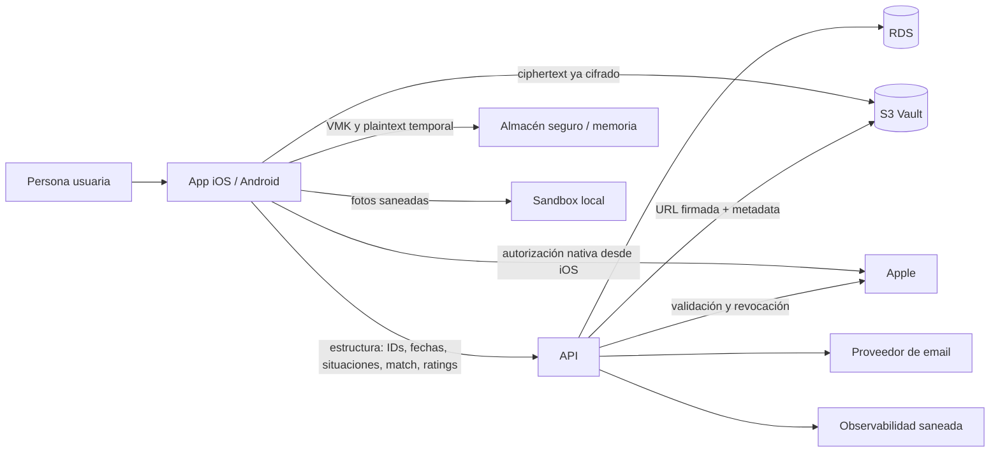

# Blueprint de Producto — MyDuckingLife (MDL)

> **Versión documental:** 1.3 — definición funcional de la beta de lanzamiento para revisión de Business/Product y preparación de conversaciones con asesoría.
> **Fecha de corte documental:** 7 de octubre de 2026.
> **Ámbito:** propuesta de valor, alcance, actores, casos de uso, información tratada, arquitectura funcional y límites de la beta activa para iOS y API; Android se prepara para una distribución futura y no bloquea esta beta.
> **Baseline:** la beta incorpora el Vault E2EE y el modelo de relaciones por situaciones, períodos e hitos descrito en este documento.
> **Distribución de datos relacionales:** los IDs, situaciones, motivos, fechas, asociaciones y proyecciones necesarios para reglas, Timeline y estadísticas son estructura legible para API; el relato privado de cada acontecimiento vive en `place` y `description` de su Experience dentro del Vault.
> **Límite:** este blueprint no asigna bases jurídicas, no declara cumplimiento normativo y no sustituye el expediente de [`docs/legal/`](../legal/README.md).

## 1. Resumen ejecutivo

MyDuckingLife (MDL) es una aplicación B2C cuya beta activa se distribuye en iOS y utiliza la API de MDL. Android se prepara como cliente posterior, fuera de esta beta. El producto se dirige a personas adultas que desean llevar un diario privado sobre personas de interés, experiencias y evolución de vínculos afectivos. No es una red social: no publica perfiles, no conecta a las personas descritas entre sí y no permite administrar contenido ajeno.

La propuesta de valor combina:

- un registro cronológico estructurado de crushes, experiencias y relaciones;
- contenido íntimo cifrado de extremo a extremo mediante el Private Journal Vault;
- fotos privadas conservadas únicamente en el dispositivo durante la beta;
- estadísticas personales calculadas sobre los datos estructurales de la propia cuenta;
- recuperación del Vault mediante contraseña de recuperación o frase de 24 palabras.

La separación de datos es deliberada:

1. las aplicaciones cifran el contenido privado antes de transferirlo; API y almacenamiento remoto reciben ciphertext y metadata, no la clave maestra ni el texto en claro;
2. API conserva los datos estructurales que necesita para autenticación, reglas cronológicas, Timeline y estadísticas;
3. las fotos permanecen exclusivamente en el almacenamiento del dispositivo durante la beta;
4. los datos estructurales, aunque no sean texto libre, pueden identificar o permitir inferencias íntimas y siguen sujetos a minimización, seguridad, retención y derechos.

### 1.1 Objetivo del documento

Este Blueprint explica MDL en términos comprensibles para una persona responsable de negocio o producto y, a la vez, conserva suficiente precisión para que equipos técnicos y asesoría identifiquen qué hace el sistema, qué información necesita y qué límites no deben prometerse.

No es un manual de pantallas, una especificación de API ni un texto legal. Los nombres de clases, endpoints, migraciones y pruebas permanecen en la documentación técnica de cada proyecto.

### 1.2 Beneficios esperados

- **Privacidad útil:** permitir un diario íntimo recuperable sin entregar al backend el contenido privado en claro.
- **Memoria estructurada:** reconstruir la historia de cada vínculo mediante crushes, experiencias, situaciones, períodos e hitos.
- **Claridad operativa:** distinguir entre un cambio guardado en el dispositivo, uno pendiente y uno sincronizado.
- **Autoconocimiento:** ofrecer estadísticas personales sobre la estructura de la propia cuenta, sin rankings ni comparaciones sociales.
- **Control:** permitir editar, archivar, eliminar y dar de baja con resultados visibles y sin falsos éxitos.
- **Evolución responsable:** separar estructura procesable, contenido E2EE y funciones futuras para que cada nueva finalidad pueda evaluarse antes de activarse.

## 2. Alcance y estado del producto

### 2.1 Incluido en la beta de lanzamiento

- registro e inicio de sesión por email/contraseña; Sign in with Apple en iOS; cierre de sesión y recuperación de contraseña;
- aceptación versionada de términos y política de privacidad;
- verificación obligatoria del email antes de acceder al diario o configurar el Vault;
- perfil de la cuenta y baja de cuenta;
- alta, consulta, edición, archivo y eliminación de crushes;
- experiencias y relaciones mediante situaciones, períodos, hitos y cierres con Timeline cronológico;
- Vault E2EE, sincronización durable y recuperación en un dispositivo sustituto;
- fotos locales saneadas, sin backup remoto de MDL;
- mapa aproximado por país y dashboard de estadísticas personales;
- textos visibles en español de España (`es-ES`), con claves internas en inglés.

### 2.2 No incluido en la beta

- perfiles públicos, mensajería o interacción social;
- panel de administración de contenido;
- pagos o suscripciones activas;
- backup remoto de fotos o videos;
- uso simultáneo normal del mismo Vault en varios dispositivos;
- tests de personalidad o apego como función final;
- notificaciones push completas;
- exportación portable completa del Vault;
- estadísticas comparativas entre usuarios;
- almacenamiento remoto o análisis de texto libre relacional fuera del Vault.
- cliente Android y «Continuar con Google», que requieren una distribución posterior con gates propios y no bloquean esta beta.

Sign in with Apple forma parte del acceso de la beta iOS. Sign in with Google se reserva para una distribución Android posterior. iOS conserva email y contraseña y no muestra Google; cuando Android se habilite, conservará email y contraseña, mostrará Google y no mostrará Apple. Una cuenta creada con un proveedor puede establecer su primera contraseña mediante el email vigente y verificado y, una vez habilitada la otra plataforma, acceder al mismo `User` y Vault.

### 2.3 Restricciones de negocio

- Sólo pueden registrarse personas de 18 años o más.
- Cada cuenta accede únicamente a sus propios datos.
- La beta es gratuita.
- La persona descrita en un crush normalmente no tiene cuenta ni interacción directa con MDL.
- No existe un actor administrador en la aplicación. El acceso operativo a infraestructura, logs o soporte debe limitarse por rol, necesidad y trazabilidad.

### 2.4 Premisas funcionales

| ID | Premisa |
|---|---|
| PR-01 | MDL es un diario privado B2C para personas adultas; no es una red social ni un sistema para gestionar contenido ajeno. |
| PR-02 | Cada cuenta sólo puede operar sobre sus propios crushes, experiencias, relaciones, Vault y estadísticas. |
| PR-03 | La tercera persona descrita no crea una cuenta por aparecer en el diario y no recibe ninguna interacción de MDL. |
| PR-04 | Las aplicaciones autorizadas son la única capa que recibe la VMK y descifra el contenido privado del Vault. |
| PR-05 | API es fuente de verdad de IDs, códigos, fechas, asociaciones, invariantes y métricas estructurales. |
| PR-06 | El contenido privado del Crush y `place`/`description` de cada Experience se cifra antes de salir del dispositivo. |
| PR-07 | Las fechas funcionales son días civiles `yyyy-MM-dd`; no se reinterpretan como instantes UTC para ordenar el diario. |
| PR-08 | Guardado local y sincronización remota son estados distintos. La interfaz no confirma sincronización sin evidencia de API y Vault. |
| PR-09 | La beta utiliza un único dispositivo activo por Vault; recovery sustituye el dispositivo y no habilita edición concurrente normal. |
| PR-10 | Un fallo de red, validación o autorización nunca se presenta como operación completada. |
| PR-11 | El modelo de relaciones descrito en §6 es la única representación funcional de la beta. |
| PR-12 | Las obligaciones legales, bases de tratamiento y plazos públicos sólo se fijan en el expediente Legal con aprobación profesional. |

## 3. Actores

| Actor | Papel | Interacciones principales |
|---|---|---|
| Persona visitante | Aún no autenticada | Registro, login, recuperación y consulta de textos legales vigentes |
| Persona usuaria | Titular de la cuenta | Gestiona su diario, Vault, fotos locales, perfil, estadísticas y baja |
| Tercera persona descrita | Persona incluida por el usuario en un crush | No crea cuenta, no recibe perfil público y no participa en el registro |
| App iOS; futura app Android | Clientes de confianza para el Vault | iOS cubre la beta activa; cada cliente habilitado valida UI, cifra/descifra, custodia claves y conserva fotos y operaciones durables |
| API | Backend funcional | Autentica, autoriza, aplica reglas, conserva estructura y metadata, calcula estadísticas |
| Procesos programados | Operación técnica | Expiran sesiones/OTP, purgan datos elegibles y procesan inactividad |
| Proveedores | Infraestructura o servicios auxiliares | AWS, proveedor de email, Sentry y Apple según el flujo correspondiente |
| Personal autorizado | Seguridad, soporte u operación | Acceso excepcional y trazado a sistemas técnicos; nunca mediante un perfil social o panel de lectura del diario |

### 3.1 Matriz de acceso funcional

| Capacidad o información | Visitante | Persona usuaria | Aplicación con Vault desbloqueado | API/procesos | Personal autorizado |
|---|---:|---:|---:|---:|---:|
| Registro, login, recovery y textos legales | Sí | Sí | Intermedia | Ejecuta y registra estado | Sólo soporte técnico limitado |
| Datos estructurales de su cuenta | No | Sí | Presentan y modifican | Lee/procesa por necesidad funcional | Excepcional, por rol y trazabilidad |
| Plaintext del contenido Vault | No | Sí | Descifra temporalmente | No | No |
| Ciphertext y metadata Vault | No | No directamente | Sincroniza | Almacena/autoriza sin descifrar | Excepcional sobre metadata, nunca VMK/plaintext |
| Diario de otra cuenta | No | No | No | Sólo procesa bajo autorización del propietario correspondiente | No como función de soporte ordinaria |
| Estadísticas personales | No | Sí | Presenta | Calcula desde estructura autorizada | No como función ordinaria |
| Baja de cuenta | No | Inicia y confirma | Limpia estado local | Revoca acceso y aplica el ciclo post-baja | Sólo asistencia excepcional; no suplanta confirmación sin procedimiento aprobado |

La matriz expresa capacidades funcionales, no una base jurídica ni autorización laboral. Los accesos de infraestructura se definen y auditan fuera de la aplicación.

## 4. Mapa funcional y casos de uso

### 4.1 Catálogo de casos de uso

| ID | Caso de uso | Actor principal | Resultado esperado | Disponibilidad en beta |
|---|---|---|---|---|
| CU-01 | Registrarse e iniciar/cerrar sesión | Visitante / persona usuaria | Cuenta y sesión propias, con aceptaciones versionadas | Incluido |
| CU-02 | Recuperar el acceso a la cuenta | Persona usuaria | Nueva contraseña de acceso tras desafío temporal | Incluido |
| CU-03 | Configurar, desbloquear o recuperar el Vault | Persona usuaria | VMK disponible sólo en el dispositivo autorizado | Incluido |
| CU-04 | Consultar y editar el perfil | Persona usuaria | Datos de cuenta actualizados bajo validación | Incluido |
| CU-05 | Crear el bundle inicial de un crush | Persona usuaria | Crush, período inicial, hito inicial y experiencia inicial obligatoria coherentes | Incluido |
| CU-06 | Consultar, editar, archivar o restaurar un crush | Persona usuaria | Ficha y visibilidad actualizadas | Incluido |
| CU-07 | Crear, editar, vincular o eliminar una experiencia | Persona usuaria | Timeline actualizado sin duplicados del mismo día | Incluido |
| CU-08 | Cambiar, cerrar, retomar o corregir una situación relacional | Persona usuaria | Períodos, situaciones e hitos coherentes, cada hito con su Experience | Incluido |
| CU-09 | Consultar y operar el Timeline | Persona usuaria | Cronología reconstruida desde entidades y pendientes | Incluido |
| CU-10 | Consultar estadísticas personales | Persona usuaria | Métricas propias con estados vacíos y límites éticos | Incluido |
| CU-11 | Eliminar una entidad del diario | Persona usuaria | Estructura, blobs y artefactos correspondientes retirados | Incluido |
| CU-12 | Dar de baja la cuenta | Persona usuaria | Acceso revocado y ciclo de retirada y tratamiento post-baja iniciado | Incluido |

La verificación de email y Sign in with Apple en iOS forman parte de CU-01/CU-04 de la beta activa. Sign in with Google se incorpora al mismo `User`, sesión, namespace y Vault sólo cuando se habilite la distribución Android posterior.

### 4.2 Flujo funcional común de escritura

1. La persona abre un formulario sobre su propia cuenta y, cuando hay contenido privado, desbloquea el Vault.
2. La aplicación precarga datos confirmados y, si corresponde, una proyección pendiente del mismo crush y dominio.
3. La persona completa los campos. La interfaz distingue obligatorios, opcionales y valores automáticos.
4. La aplicación valida formato y reglas conocidas, congela UUID y días civiles, y construye un snapshot coherente.
5. El snapshot se cifra y la intención se guarda localmente antes de utilizar la red.
6. La app puede comunicar “Guardado en este dispositivo”; todavía no comunica “Sincronizado”.
7. API recibe únicamente la estructura autorizada, aplica propiedad, invariantes e idempotencia y crea los bindings del Vault correspondientes.
8. La aplicación sincroniza el ciphertext, verifica la revisión remota y sólo entonces retira la intención pendiente.
9. La interfaz reconstruye la vista con la entidad confirmada y comunica el estado final.

Si el formulario sólo modifica datos de cuenta no pertenecientes al Vault, se omiten los pasos criptográficos que no correspondan, pero se conservan autorización, validación y confirmación real.

### 4.3 CU-01 y CU-02 — Cuenta, sesión y recuperación

**Objetivo.** Crear y recuperar una identidad de cuenta propia, mantener una sesión revocable y registrar las versiones legales aceptadas.

**Entradas principales.** Email normalizado y contraseña para el canal propio; credencial federada y continuación segura para Apple o Google en su plataforma; fecha completa de nacimiento, aceptaciones requeridas y, cuando aplique, código temporal de recuperación. El género y el país son datos opcionales del perfil de la cuenta.

**Flujo principal.**

1. La persona consulta y acepta las versiones vigentes de términos y privacidad.
2. En la beta activa crea una cuenta con email/contraseña o con Apple desde iOS. Google desde Android se habilita sólo en una distribución posterior. Todos los canales habilitados crean o vinculan el mismo `User`. Si una identidad federada nueva llega con un email que ya pertenece a una cuenta MDL, API no crea cuenta ni sesión: la aplicación exige acreditar expresamente esa cuenta antes de vincular el proveedor. Private Relay o un email diferente conservan una entrada explícita para quien ya tenga cuenta. En ningún caso se fusionan cuentas automáticamente por coincidencia de email.
3. Una cuenta creada por email nace provisional y sólo accede al flujo de verificación. El código tiene seis dígitos y el plazo total para verificar es de siete días desde el alta; los reenvíos no lo extienden.
4. Un alta Apple o Google con email acreditado como verificado nace verificada y no recibe OTP. Una cuenta creada con proveedor puede existir sin contraseña MDL.
5. La sesión tiene una duración máxima de siete días desde la emisión del token y puede revocarse antes.
6. Los flujos de recuperación y verificación usan respuestas diseñadas para evitar enumeración de cuentas. Las credenciales de acceso y los secretos de recuperación del Vault son distintos. Una cuenta federada sin contraseña puede establecer la primera mediante su email vigente y verificado para acceder desde la otra plataforma al mismo `User` y Vault.

**Resultado.** Con la identidad verificada, la persona accede únicamente a su namespace. Cerrar sesión revoca el token correspondiente y limpia el contexto sensible local sin eliminar la cuenta. Una cuenta provisional que no verifica en siete días se elimina y libera el email sin conservarlo como lead.

**Alternativas y límites.** Un código inválido, expirado o excedido no cambia la contraseña. Cancelar Apple o Google, o presentar una credencial inválida, no crea, vincula ni autentica una cuenta.

### 4.4 CU-03 — Configuración, desbloqueo y recuperación del Vault

**Objetivo.** Mantener el contenido privado recuperable sin que API, S3 ni el personal operativo reciban la VMK o el plaintext.

**Precondiciones.** Cuenta autenticada, estado de Vault conocido y controles de seguridad de cuenta exigibles completados.

**Flujo principal.**

1. La aplicación genera una Vault Master Key (VMK) aleatoria por cuenta.
2. La VMK se mantiene en el dispositivo y se encapsula por separado para recuperación mediante contraseña y frase de 24 palabras.
3. API almacena las encapsulaciones y metadata necesarias, pero no recibe la VMK en claro.
4. En un dispositivo sin estado local, la app comprueba si existe un Vault remoto. Si existe, exige recovery y no crea otro Vault que lo sobrescriba.
5. La beta utiliza un único dispositivo activo por Vault. Recovery sustituye el dispositivo; no promete sincronización concurrente continua entre dos copias activas.

**Resultado.** La app publica el conjunto recuperado sólo después de descargar, descifrar y validar un inventario inequívoco. Un fallo conserva el Vault remoto y no crea otro encima.

**Alternativas y límites.** Una credencial de recovery incorrecta no entrega pistas sobre la VMK. La transferencia QR no es un método normal de beta. Perder todos los mecanismos de recuperación puede hacer irrecuperable el contenido E2EE.

### 4.5 CU-04 — Perfil y ajustes de cuenta

**Objetivo.** Consultar y modificar los datos de cuenta y preferencias sin confundirlos con el contenido del diario o las credenciales del Vault.

**Flujo principal.** El formulario se precarga con valores actuales. Cada cambio distingue valor nuevo, limpieza explícita y campo no modificado. La fecha de nacimiento se trata como día civil; el idioma se aplica y persiste; App Lock protege localmente una sesión ya autenticada.

**Datos.** Email, fecha completa de nacimiento, país y género opcionales, idioma local, plan y estados funcionales de la cuenta. Su tratamiento se detalla en §5.3.

**Alternativas y límites.** Cambiar el email exige verificar la nueva dirección antes de sustituir la anterior. App Lock no revoca el token ni sustituye login/recovery. Un fallo no debe dejar la pantalla bloqueada ni mostrar datos de otra cuenta.

### 4.6 CU-05 — Crear el bundle inicial de un crush

**Objetivo.** Crear una ficha y el inicio de su cronología mediante una única intención durable.

**Precondiciones.** Sesión propia, Vault desbloqueado y ausencia de otra creación root pendiente para el mismo UUID.

**Entradas.** Los campos obligatorios y su ubicación se detallan en §5.3. La experiencia inicial es obligatoria y debe quedar completa.

**Flujo principal.**

El alta crea un bundle inicial compuesto por:

- crush;
- primer período relacional obligatorio con fecha igual a `met_at`;
- hito inicial obligatorio con la situación elegida;
- experiencia inicial obligatoria y completa, también en `met_at`.

El cliente congela UUID y día civil antes de enviar. Un retry reutiliza la misma identidad y no crea un duplicado.

API recibe la identidad del Crush, edad y fecha de referencia, país, categoría Ducky, rasgos físicos, valoraciones, `met_at`, situación inicial, satisfacción y asociaciones. La aplicación cifra el nombre, `gender_id`, profesión, contacto, redes y día/mes de cumpleaños del Crush, además del lugar y la descripción de la Experience inicial.

**Resultado.** Lista, detalle y Timeline muestran una sola identidad de crush. Mientras sólo exista guardado local, la proyección se distingue del estado confirmado.

**Alternativas.** Un formulario incompleto no genera intención ni request. Un rechazo confirmado permite corregir o descartar; un resultado de red ambiguo se reconcilia reutilizando IDs antes de permitir un borrado normal.

### 4.7 CU-06 — Consultar y gestionar un crush

**Objetivo.** Consultar la ficha combinando estructura API y contenido Vault, editarla sin cambiar su identidad y controlar si aparece en la lista activa.

**Flujo principal.** La aplicación obtiene la estructura autorizada, resuelve el snapshot cifrado de la misma entidad y fusiona ambos por ID. Una edición conserva el UUID. Archivar modifica visibilidad, no elimina la ficha ni su historia; restaurar la devuelve a activos.

**Alternativas.** Si el Vault está bloqueado, no se muestra plaintext privado. Una edición de `met_at` mueve con ella el bundle inicial y aplica los dos límites definidos en `RP-CRU-007..009`: sin acontecimientos independientes puede llegar hasta hoy; con ellos puede llegar como máximo al día anterior al primero, sin límite histórico hacia atrás.

### 4.8 CU-07 — Experiencias

**Objetivo.** Registrar un acontecimiento en un día civil como experiencia independiente dentro de un período o vinculado a un cambio relacional.

**Entradas.** Fecha y satisfacción estructurales; lugar y descripción privados. Los campos exactos están en §5.3.

**Flujo principal.**

Una experiencia pertenece a un crush, a un único período relacional y a un día civil. Contiene fecha, satisfacción y asociaciones estructurales; lugar y descripción viven en el Vault cifrado.

Sólo puede existir una experiencia por Crush y día; otros Crushes pueden registrar sus propias Experiences en esa misma fecha. Una experiencia puede existir sin hito relacional, pero nunca fuera del intervalo de su período; toda creación de período o cambio relacional exige una experiencia vinculada del mismo día. «Añadir experiencia» limita la fecha al intervalo continuo de RP-EXP-011 y hoy. Ambas partes se presentan como una unidad en el Timeline. El Timeline se reconstruye a partir de las entidades y sus correlaciones; no es una fuente independiente de datos.

**Edición y borrado.** La experiencia conserva su UUID al editarse. Una Experience independiente puede moverse dentro de su mismo período y atravesar hitos, pero no salir del período ni ocupar el día de un hito. Si está vinculada, su fecha se mantiene alineada con el hito. No existe una acción manual para vincularla o desvincularla. Una Experience independiente puede eliminarse sin límite de antigüedad; eliminar una vinculada al último hito posterior elegible elimina ambas partes atómicamente y un hito histórico se rechaza. Eliminar sólo ese hito conserva la Experience como independiente dentro del mismo período. Un período posterior sólo puede eliminarse cuando su hito inicial es también su único hito; la operación elimina el período, ese hito y todas sus Experiences. La Experience del bloque inicial nunca se elimina por separado del Crush.

### 4.9 CU-08 — Situaciones, períodos e hitos

**Objetivo.** Representar el estado exacto y visible de un vínculo mediante situaciones, conservar cada cambio real como hito y dividir la historia en períodos continuos.

**Precondiciones.** Crush existente, Vault desbloqueado para completar la Experience y cronología compatible con las reglas de §6.

**Flujo principal.**

1. Todo período comienza con un hito inicial y una Experience obligatoria. El período inicial forma parte del alta del Crush; un período posterior sólo nace después de que el anterior haya quedado `CLOSED`.
2. Mientras el período está vivo, «Añadir experiencia» permite guardar una Experience independiente o añadir un segundo paso opcional con una nueva `RelationshipSituation`.
3. No existe una entrada directa separada «Cambiar situación». Todo cambio posterior al bloque inicial se registra desde «Añadir experiencia»: primero se completa la Experience y después se elige la situación y, si corresponde, el motivo de cierre.
4. Cada hito conserva la situación anterior, la resultante, la fecha, el orden y el vínculo obligatorio con su Experience; coincidir en fecha no crea el vínculo.
5. Cerrar registra la situación `CLOSED`, uno de los once motivos admitidos y una Experience completa en una fecha posterior a todos los hitos y Experiences que el período ya contiene. El relato privado pertenece a `description` de esa Experience. Una corrección a `CLOSED` se rechaza si su fecha inmutable dejaría una Experience posterior; nunca mueve ni elimina datos para fabricar el cierre.
6. Con el último período cerrado, «Añadir experiencia» completa primero la Experience y después exige la situación inicial que permita la historia conservada. `NOT_TALKING` sólo continúa disponible si nunca se alcanzó 2–9. El único recorrido crea de forma atómica Experience, período nuevo e hito inicial. El período anterior permanece cerrado.
7. La aplicación guarda la intención cifrada; API valida trayecto, orden, unicidad, propiedad y códigos; Vault sincroniza el snapshot privado de la Experience.

**Resultado.** Timeline y estadísticas pueden consultar situaciones, períodos, hitos, cierres y proyecciones de match sin acceder al relato privado.

**Alternativas y límites.** Mientras existe un período vivo, una Experience puede registrarse como independiente dentro de él o junto con un cambio relacional. Si el período más reciente está cerrado, la siguiente Experience exige una situación inicial admitida por RP-REL-007 y crea atómicamente el período nuevo y su hito inicial. Borrar una Experience vinculada exige borrar también su hito y respetar `latest-only`. Sólo el período no inicial más reciente puede eliminarse, y únicamente cuando su hito inicial continúa siendo su único hito; se elimina completo con todas sus Experiences, sin reabrir el anterior ni dejar ninguna fuera de un período.

### 4.10 CU-09 — Timeline

**Objetivo.** Presentar una cronología determinista de altas, experiencias y cambios relacionales.

**Flujo principal.** El sistema obtiene las entidades activas, agrupa las que comparten correlación y día, fusiona sus snapshots Vault y aplica proyecciones pendientes del mismo scope. El bundle inicial aparece una vez; una Experience y su hito vinculado aparecen como una unidad.

**Acciones.** Las acciones dependen del tipo de tarjeta, su identidad, su período y la seguridad de la información disponible. Una tarjeta histórica no ofrece mutaciones que la regla de dominio prohíba.

**Alternativas.** Datos insuficientes degradan una acción a sólo lectura. Los empates se ordenan de forma estable y una recarga no debe duplicar ni hacer desaparecer temporalmente una entidad.

### 4.11 CU-10 — Estadísticas personales

**Objetivo.** Resumir patrones de la propia cuenta mediante datos estructurales, sin convertir el diario en una clasificación de personas.

**Entradas.** Match del Crush, primera situación de match, situaciones vigentes, fechas, ratings, satisfacción, Ducky, rasgos, zodíaco, países y asociaciones estructurales autorizadas. El contenido Vault no se utiliza.

**Resultado.** La persona recibe el dashboard personal de beta con métricas redondeadas, la muestra utilizada y estados vacíos cuando no existen datos elegibles. No se presentan causalidades ni comparaciones competitivas.

### 4.12 CU-11 — Eliminación individual

**Objetivo.** Retirar una Experience, un hito o período elegible, o un Crush, junto con todos los artefactos que dependan de la operación elegida.

**Flujo principal.** La persona confirma; la aplicación resuelve pendientes; API aplica el borrado funcional y marca los blobs vinculados; la aplicación limpia entries y contenido local; la purga física remota ocurre después de la ventana técnica aplicable.

**Resultado.** La entidad deja de mostrarse y de alimentar funciones ordinarias. No se comunica éxito mientras alguna capa necesaria haya fallado.

### 4.13 CU-12 — Baja de cuenta

**Objetivo.** Revocar el acceso y ejecutar el ciclo integral descrito en §8.3.

**Flujo principal.** La persona recibe información sobre consecuencias, confirma, y el sistema revoca sesiones y la autorización Apple vinculada, retira Vault y recovery, elimina artefactos locales y procesa la estructura conforme a la política aprobada.

**Resultado.** No queda una sesión funcional ni un Vault recuperable por el flujo ordinario. Cualquier conservación posterior debe responder a finalidad, plazo y salvaguardas aprobados.

### 4.14 Resumen de archivo, borrado y baja

- Archivar oculta un crush de la lista activa sin eliminarlo.
- Eliminar una Experience, hito o período elegible aplica el alcance compuesto definido para esa acción y retira las revisiones Vault afectadas.
- Eliminar un crush coordina estructura, relaciones, experiencias, bindings, blobs, entradas locales y fotos del dispositivo.
- Dar de baja la cuenta revoca sesiones, retira el Vault y sus mecanismos de recuperación, borra artefactos locales y aplica a la estructura el tratamiento post-baja aprobado.

La estructura que Product propone conservar después de la baja se trata como seudonimizada y permanece fuera de uso hasta que Legal apruebe finalidad, base, campos, plazo, acceso y salvaguardas; ver §8.3 y el expediente Legal.

### 4.15 Superficies funcionales

No se incluyen mockups ni capturas. Esta matriz identifica qué debe permitir cada superficie sin imponer un diseño visual concreto.

| Superficie | Información principal | Acciones principales |
|---|---|---|
| Acceso y textos legales | email, credencial propia o Apple, versiones vigentes y estado de sesión/verificación | registro, login, verificación, recuperación, aceptación y logout |
| Home / lista | crushes activos, situación vigente, match y cambios pendientes | abrir, buscar/filtrar, iniciar alta y acceder a archivados |
| Alta y perfil de crush | estructura autorizada y contenido privado descifrado localmente | crear bundle, editar ficha, archivar, restaurar o eliminar |
| Experiencia | fecha, satisfacción, vínculo y texto Vault | crear, editar, añadir opcionalmente un cambio de situación y eliminar según elegibilidad |
| Relación | situación, período, hitos y motivo de cierre | cambiar situación, cerrar, retomar y corregir donde esté permitido; cada acción crea también su Experience |
| Timeline | bundles, experiencias, períodos y estados pendientes | consultar y abrir únicamente las acciones válidas para cada tarjeta |
| Estadísticas | métricas personales, filtros y estados sin muestra | consultar sin acceder a contenido Vault |
| Vault y recovery | estado, método de recuperación y progreso | configurar, desbloquear y recuperar en dispositivo sustituto |
| Ajustes y perfil de cuenta | cuenta, idioma, App Lock y funciones disponibles | editar perfil, seguridad, logout y baja |
| Estado de sincronización | etapa, motivo saneado y alcance de la operación | cerrar, retry, corregir o descartar únicamente cuando sea seguro |

## 5. Modelo de dominio

### 5.1 Entidades principales

| Entidad | Propósito | Datos estructurales visibles para API | Contenido privado E2EE |
|---|---|---|---|
| User | Cuenta autenticada | UUID, email cifrado recuperable por API, password hash cuando existe, fecha de nacimiento declarada, país/género de perfil, plan, verificación, flags, sesión y aceptaciones | Son datos de cuenta administrados por API y permanecen fuera del Vault |
| FederatedIdentity | Acceso vinculado mediante Apple | identificador Apple protegido, digest de búsqueda, email/Private Relay, estado y material técnico de revocación | No pertenece al Vault; los valores sensibles se cifran en API y nunca se registran en logs |
| Crush | Ficha privada de una tercera persona | UUID, edad y `age_as_of`, país, categoría, rasgos físicos, ratings, `met_at`, archivo, `match_status_id`, primera situación y fecha de match | nombre, `gender_id`, profesión, contacto/redes y día/mes de cumpleaños |
| Experience | Acontecimiento con un Crush | UUID, propietarios, fecha, satisfacción, período obligatorio, correlación y hito derivado cuando existe | lugar y descripción |
| RelationshipPeriod | Tramo continuo de la historia | UUID, propietarios, inicio/fin, situación vigente, correlación y ciclo de vida | Sin payload Vault propio |
| RelationshipMilestone | Inicio del período o cambio real de situación | UUID, período, Experience obligatoria, secuencia, fecha efectiva, situación anterior/resultante, motivo de cierre cuando corresponde y capacidades | Sin payload Vault propio; la explicación permanece en la Experience vinculada |
| Vault | Contenedor E2EE de una cuenta | propietario, versión criptográfica y estado | No contiene plaintext en backend |
| VaultBlob | Revisión cifrada de una entidad | tipo, tamaño, hash, ruta, versión, secuencia, timestamps y soft delete | snapshot ciphertext |
| VaultEntityBinding | Vínculo opaco entre un Crush o Experience y sus revisiones | tipo, ID funcional y token opaco | El token no revela el contenido sin VMK |
| VaultDevice / encapsulaciones | Recovery y autorización técnica | identificadores, fingerprints, fechas y estado | material encapsulado, nunca VMK en claro |
| ActivityEvent | Soporte del Timeline/feed | IDs de entidad, tipo de evento y fecha | No debe contener contenido Vault |
| AuditEvent / AuthEvent / SecurityAlert | Seguridad e investigación | IDs, ruta/evento, resultado, IP/user agent cuando proceda, trace ID y timestamps | No debe contener contenido Vault ni secretos |
| AccountDeletionFeedback | Gestión de la baja | motivo, texto opcional, estado y recibo | No pertenece al Vault; el texto libre debe evitarse o minimizarse y tratarse como potencialmente personal |

### 5.2 Catálogos y derivados

Los catálogos incluyen país, género, categoría Ducky, satisfacción, rasgos físicos, signo zodiacal, motivo de cierre, plan y versiones legales. `RelationshipSituation` y `MatchStatus` son Value Objects cerrados cuyos enteros se guardan directamente; no utilizan tablas de catálogo.

Datos derivados principales:

- comprobación de mayoría de edad del usuario desde la fecha de nacimiento declarada, sin conservar ni mostrar además una edad exacta;
- edad actual estimada del crush desde `age`, `age_as_of` y, si existe, día/mes del cumpleaños cifrado;
- signo zodiacal calculado en la aplicación y enviado como categoría estructural;
- rating global como promedio de ratings disponibles;
- `match_status_id`, `first_match_situation_id` y `first_match_date` del Crush desde los hitos conservados;
- situación y fechas vigentes de cada período desde sus hitos;
- estadísticas personales desde la estructura de la cuenta.

Un derivado puede seguir siendo dato personal o revelar información sensible. “Calculado” no equivale a “anónimo”.

### 5.3 Matriz funcional de campos

Las tablas siguientes describen las categorías funcionales y el modelo físico objetivo de la beta.

#### Cuenta

| Campo o grupo | Condición | Origen | Tratamiento principal |
|---|---|---|---|
| UUID de cuenta | Automático | API | Legible para API; identifica propietario y namespace |
| Email | Obligatorio | Persona usuaria o Apple | Cifrado de forma recuperable por API sólo para acceso, verificación, recuperación, cambio y comunicaciones autorizadas; utiliza un índice exacto no reversible y no pertenece al Vault |
| Copias operativas del email | Sólo cuando las origina un alta provisional, cambio, verificación, recuperación o identidad Apple | Persona usuaria, Apple o flujo de cuenta | Mantienen el mismo cifrado recuperable; colas y reintentos las transportan sólo durante la operación y no dejan una copia durable legible |
| Contraseña de acceso | Obligatoria en alta por email | Persona usuaria | API conserva únicamente hash; no pertenece al Vault |
| Identidad Apple | Obligatoria sólo para ese canal | Apple + persona usuaria | `sub` protegido, digest de unicidad y material técnico cifrado; no pertenece al Vault |
| Estado/plazo de verificación | Automático | API | Una cuenta por email permanece provisional hasta verificar y vence a los siete días |
| Aceptaciones legales | Obligatorias cuando corresponda | Persona usuaria + versión publicada | API conserva documento, versión y evidencia temporal |
| Fecha de nacimiento | Obligatoria para mayoría de edad | Persona usuaria | Fecha completa declarada, legible para API y conservada con la fecha del alta; no se guarda además una edad exacta |
| País y género de perfil | Opcionales | Persona usuaria | IDs estructurados legibles para API y editables desde el perfil |
| Plan, flags y timestamps | Automáticos o funcionales | API/aplicaciones | Estructura legible para API |
| Tokens de sesión | Automáticos | API | Secretos revocables; nunca se guardan en logs ni en el Vault |

El perfil personal de la cuenta está formado exactamente por `birth_date` y los IDs opcionales `gender_id` y `country_id`. Email, contraseña y métodos de acceso se gestionan mediante sus flujos propios.

#### Crush

| Campo o grupo | Condición | API/RDS | Vault E2EE |
|---|---|---:|---:|
| UUID, propietario y correlación | Automáticos | Sí | El binding opaco identifica la entidad; no son contenido del perfil Vault |
| Nombre | Obligatorio | No | Sí |
| Género | Obligatorio | No | `gender_id` existe exclusivamente dentro del payload Vault |
| País y categoría Ducky | Obligatorios | IDs estructurados | No |
| `met_at`, edad y `age_as_of` | Obligatorios | Sí | No |
| Match y primer match | Automáticos y recalculables | `match_status_id`, `first_match_situation_id`, `first_match_date` | No |
| Rasgos y ratings individuales | Opcionales; ratings sólo editables desde perfil | IDs/valores estructurados | No |
| Rating global | Derivado | API lo recalcula | No se acepta como verdad enviada por cliente |
| Signo zodiacal | Derivado del cumpleaños | `zodiac_id` | El cumpleaños continúa sólo en Vault |
| Profesión, contacto y redes | Opcionales | No | Sí |
| Día/mes de cumpleaños | Opcional | No | Sí |
| Archivo, timestamps y derivados | Automáticos | Sí | No contienen texto privado |

#### Experiencia

| Campo o grupo | Condición | API/RDS | Vault E2EE |
|---|---|---:|---:|
| UUID, crush y propietario | Automáticos | Sí | El binding opaco identifica la experiencia; no son contenido del payload Vault |
| Día civil | Obligatorio | Sí | No |
| Satisfacción | Obligatoria en toda Experience; entero 1–5 | ID estructurado | No |
| Lugar y descripción | Obligatorios; `place` hasta 255 caracteres y `description` hasta 5.000 | No | Sí |
| Período y correlación | Período obligatorio; correlación administrada por el sistema | Sí | No |
| Hito vinculado | Derivado; sólo cuando un hito apunta a la Experience | Sí | No |
| Timestamps y estado de borrado | Automáticos | Sí | Metadata, no contenido privado |

El payload Vault de una Experience contiene exactamente `place` y `description`. `satisfaction_id` pertenece exclusivamente a la estructura funcional y no se duplica dentro del ciphertext.

#### Período relacional

| Campo o grupo | Condición funcional | API/RDS | Vault E2EE |
|---|---|---:|---:|
| UUID, propietario y Crush | Obligatorios | Sí | Sin binding ni payload propio |
| Inicio y fin | Inicio obligatorio; fin sólo cuando la situación vigente es `CLOSED` | Sí | No |
| Situación vigente | `current_situation_id` obligatorio | ID entero de `RelationshipSituation` | No |
| Correlación y ciclo de vida | Administrados por el sistema | Sí | No |

#### Hito relacional

| Campo o grupo | Condición funcional | API/RDS | Vault E2EE |
|---|---|---:|---:|
| UUID y período | Obligatorios e inmutables | Sí | Sin binding ni payload propio |
| Experience vinculada | Obligatoria y única | `experience_id` | La Experience conserva `place` y `description` |
| Orden y día efectivo | Obligatorios | `sequence`, `effective_date` | No |
| Situación anterior y resultante | La anterior sólo es nula en el hito inicial | IDs enteros de `RelationshipSituation` | No |
| Motivo de cierre | Sólo cuando la situación resultante es `CLOSED` | `closure_reason_id` | No |
| Correlación y capacidades | Acción compuesta y elegibilidad `latest-only` | Sí | No |

El snapshot local cifrado de una operación durable puede contener la estructura necesaria para repetir esa operación. Ese snapshot no amplía el contenido funcional del Vault remoto ni cambia qué campos interpreta la API.

### 5.4 Datos especialmente delicados

Aunque MDL no debe calificarlos jurídicamente por sí mismo, requieren especial cautela:

- contenido libre sobre vida afectiva o sexual;
- nombres, contactos, redes y cumpleaños de terceras personas;
- situaciones, match, motivos de cierre, fechas y satisfacción que permitan inferir intimidad;
- combinaciones poco frecuentes de atributos estructurados que faciliten reidentificación;
- credenciales, VMK, encapsulaciones, tokens, IP y contexto de seguridad.

No se incluyen estos valores en logs, mensajes de error ni analítica de producto.

## 6. Relaciones

### 6.1 Modelo funcional

Cada Crush nace con un período relacional, un hito inicial y una Experience completa en `met_at`. Una `RelationshipSituation` describe directamente el estado exacto y visible; el período conserva un tramo continuo y cada hito registra el inicio o un cambio real. Cada hito tiene exactamente una Experience que explica qué ocurrió.

Las claves internas y los campos de transporte permanecen en inglés. La beta presenta el texto visible en español de España sin cambiar el ID ni el significado almacenado.

### 6.2 Situaciones y trayectos

`RelationshipSituation` admite exactamente:

| ID | Clave interna | Texto visible `es-ES` | Evidencia de match |
|---:|---|---|---|
| 1 | `NOT_TALKING` | Todavía no hemos hablado | No lo establece |
| 2 | `ACQUAINTED` | Nos conocemos / hablamos | No lo establece |
| 3 | `FRIENDS` | Solo somos amigos | No lo establece |
| 4 | `MUTUAL_INTEREST` | Hay química, pero aún no hemos quedado | No lo establece |
| 5 | `DATING` | Estamos saliendo | Establece match |
| 6 | `CASUAL` | Algo casual | Establece match |
| 7 | `FWB` | Amigos con derecho | Establece match |
| 8 | `RELATIONSHIP` | Estamos en una relación | Establece match |
| 9 | `UNDEFINED` | Hay algo, pero prefiero no etiquetarlo | Establece match |
| 10 | `CLOSED` | Historia cerrada | Cierra el período |

El alta admite como situación inicial cualquiera de 1–9. Dentro de un período, los trayectos son:

- desde `NOT_TALKING` → cualquiera de 2–9 o `CLOSED`;
- desde `ACQUAINTED` → cualquiera de 3–9 o `CLOSED`;
- desde `FRIENDS` → cualquiera de 4–9 o `CLOSED`;
- `MUTUAL_INTEREST` → cualquiera de 5–9 o `CLOSED`;
- desde cualquiera de 5–9 → cualquiera de las otras cuatro situaciones de ese grupo o `CLOSED`.

La persona elige explícitamente el estado actual y puede saltar hacia adelante sin fabricar situaciones intermedias; MDL no lo deduce del texto ni de otros datos de la Experience. Dentro del mismo período no se retrocede de 5–9 a 1–4 y repetir la situación vigente no crea un hito; la Experience puede guardarse como independiente si el período sigue vivo.

### 6.3 Cierre, retoma y correcciones

- Cerrar finaliza el período vigente y exige un hito `CLOSED`, fecha, motivo catalogado y Experience completa.
- El motivo es estructura legible; el relato privado del cierre vive en `description` de la Experience vinculada.
- Retomar crea un período separado con hito y Experience iniciales; no borra, reabre ni estira el período anterior.
- Los días sin período activo se representan como un hueco temporal, no como una entidad ficticia.
- Un período no puede comenzar y cerrarse el mismo día porque cada hito ocupa una Experience y sólo se admite una por Crush y día civil.
- Sólo puede corregirse el último hito del período más reciente. La corrección conserva ID, fecha y Experience; cambia situación y motivo y recalcula las proyecciones.
- Eliminar el último hito posterior puede conservar su Experience como independiente o eliminar ambas partes. Los hitos históricos se rechazan sin mutación.
- `Latest-only` compara hitos entre sí: una Experience independiente posterior no impide corregir o eliminar el último hito elegible.
- Un hito inicial nunca se elimina aisladamente: el del bloque inicial desaparece con el Crush y el de un período posterior, con ese período completo.
- El período inicial desaparece únicamente con el Crush. Un período posterior sólo puede eliminarse cuando es el más reciente y su hito inicial sigue siendo su único hito; se eliminan también todas sus Experiences y el período anterior permanece cerrado.

### 6.4 Match, Timeline y estadísticas

`MatchStatus` pertenece únicamente al Crush y admite `0 UNKNOWN`, `1 MATCH` y `2 NO_MATCH`. Un hito conservado cuya situación resultante sea 5–9 establece `MATCH`; el Crush guarda además `first_match_situation_id` y `first_match_date`. Abrir otro período no reinicia un `MATCH` que conserva evidencia. Si una corrección o eliminación retira evidencia, las tres proyecciones se recalculan desde los hitos que permanecen.

Sin evidencia de match, un período vivo produce `UNKNOWN` y todos los períodos cerrados producen `NO_MATCH`. Abrir un período nuevo en una situación 1–4 puede devolver el Crush a `UNKNOWN`; abrirlo directamente en 5–9 establece `MATCH`.

API puede usar situaciones, match, motivos catalogados, fechas y asociaciones para:

- consultar la situación vigente sin reconstruir todos los hitos;
- ordenar el Timeline y agrupar en una única tarjeta una Experience con su hito atómico;
- representar cierres, períodos posteriores y huecos;
- producir estadísticas personales sin leer lugar ni descripción.

Los códigos relacionales siguen siendo información sensible por contexto aunque no sean PII textual. Se minimizan, se aíslan por propietario y se someten a retención, derechos y evaluación jurídica.

### 6.5 Contrato físico objetivo

La beta utiliza exactamente `relationship_periods`, `relationship_milestones` y `experiences`. Cada Experience pertenece obligatoriamente a un período y cada hito apunta a su Experience obligatoria. Los Value Objects de situaciones y match se guardan como enteros y no tienen tabla de catálogo.

| Aspecto | Decisión final |
|---|---|
| Schema y contrato | API conserva situaciones, motivo, fechas, IDs de período/hito y asociaciones; Vault conserva el relato dentro de la Experience. |
| Motivos de cierre | Los once valores del [catálogo de cierre](../rules/RELATIONSHIPS.md#cierre); el motivo es obligatorio al cerrar y depende de la historia confirmada. |
| Match | El Crush conserva `match_status_id` y, cuando existe, primera situación y fecha; los hitos son la evidencia recalculable. |
| Experience vinculada | Todo hito tiene exactamente una Experience del mismo día y correlación; una Experience puede existir sin hito, pero nunca sin período. |
| Eliminación y corrección | `Latest-only` compara hitos. El borrado compuesto no deja hitos sin Experience ni Experiences fuera de un período. |
| Estadísticas | El dashboard consume match y situaciones resueltos; no reconstruye la historia completa para responder cada consulta. |

## 7. Mapa de datos y almacenamiento

| Capa | Qué conserva | Qué puede leer MDL/backend |
|---|---|---|
| Memoria de la aplicación desbloqueada | Plaintext necesario para mostrar/editar, VMK durante uso y proyecciones | La app en la sesión autorizada |
| Almacén seguro de la plataforma | VMK y material local protegido | El dispositivo bajo sus controles de acceso |
| SQLite del Vault | Ciphertext, metadata, revisiones e intenciones durables | No hay índice privado persistente en plaintext |
| Sandbox de fotos | Imágenes saneadas por Crush | Sólo el dispositivo |
| API/RDS | Cuenta, estructura, catálogos, aceptaciones, eventos, bindings, encapsulaciones y metadata | Backend y personal autorizado según controles |
| S3 Vault | Objetos ciphertext | El proveedor aloja objetos cifrados; no recibe VMK desde MDL |
| Email | Dirección cifrada recuperable y mensaje transaccional | API y proveedor de entrega según la operación autorizada |
| Identidad Apple | Credencial federada, Private Relay cuando aplica y estado técnico de revocación | API y Apple según el flujo; no contiene datos Vault |
| Observabilidad | Contexto técnico minimizado | IDs técnicos, rutas, estados y trazas; nunca contenido Vault |

### Flujo simplificado

La API no descifra Vault. Sí puede relacionar metadata y estructura con una cuenta mientras ésta esté activa, por lo que el conjunto no es anónimo.

## 8. Ciclo de vida, retención y baja

### 8.1 Durante la cuenta activa

- La estructura se conserva mientras sea necesaria para prestar la función.
- Cada entidad privada tiene una revisión vigente en Vault.
- Una edición sube y verifica la revisión nueva antes de retirar la anterior; la coexistencia es transitoria y no ofrece historial de versiones al usuario.
- Una operación durable pendiente se conserva cifrada hasta sincronizar, corregir o descartarse con seguridad.

### 8.2 Borrado individual

- El borrado funcional deja de mostrar o usar ordinariamente la entidad tras confirmación.
- Sus blobs quedan soft-deleted y son elegibles para purga física después de la ventana técnica de siete días.
- El binding opaco se conserva sólo para retry y purga, y se elimina al cerrar definitivamente el grafo.
- El efecto de backups, versionado de objetos y restauraciones debe estar documentado en la política pública aprobada.
- El borrado de un crush incluye sus descendientes, Vault y fotos locales; no basta con ocultar la fila principal.

### 8.3 Baja de cuenta y estadísticas posteriores

El objetivo funcional de la baja es:

1. revocar sesiones, accesos y la autorización Apple vinculada;
2. marcar los blobs del Vault para su purga física tras la ventana técnica de siete días;
3. eliminar inmediatamente encapsulaciones, dispositivos y recovery, y conservar cada binding sólo hasta purgar su último blob;
4. retirar contenido y fotos locales después de la confirmación remota;
5. retirar identificadores directos de la cuenta y aplicar a la estructura el tratamiento aprobado;
6. retirar eventos funcionales que permitan reconstruir el diario;
7. conservar sólo lo que esté jurídicamente aprobado para obligaciones o estadísticas.

No existe un reset independiente del Vault. Recovery recupera el acceso mientras la cuenta existe; la baja retira de inmediato los mecanismos que permitirían reconstruir la VMK.

Producto propone conservar fuera del uso ordinario una estructura seudonimizada para posibles estadísticas agregadas. Ese uso permanece deshabilitado hasta que Legal apruebe finalidad, base, campos, plazo, acceso, separación y salvaguardas. Las filas que aún puedan enlazarse por UUID, secuencias o combinaciones raras continúan tratándose como potencialmente personales.

### 8.4 Retenciones técnicas de la beta

| Categoría | Regla técnica de referencia | Observación |
|---|---|---|
| Token de sesión | 7 días desde emisión | Puede revocarse antes |
| Cuenta provisional por email | 7 días desde el alta | Si no verifica, se elimina y el email queda libre; un reenvío no amplía el plazo |
| OTP de verificación | 15 minutos por código | Máximo 5 intentos; después aplica un bloqueo de 15 minutos y pruning programado |
| Continuación de Sign in with Apple | 10 minutos y un solo uso | Vinculada al dispositivo y al intento que la originó |
| Revocación Apple fallida | Hasta 30 días después del fallo final | Operación idempotente y trazada sin conservar tokens en logs |
| Inactividad | 18 meses desde `last_login` o, si falta, `email_verified_at`; después 20 días de gracia | La gracia empieza con aviso aceptado para entrega o tras el último intento ante rechazo definitivo; requiere aprobación Legal |
| ActivityEvent, AuditEvent, AuthEvent y SecurityAlert | Plazo pendiente de aprobación | DEC-09 fija necesidad, acceso y retención antes del lanzamiento |
| Aceptaciones, feedback y recibos | Plazo pendiente de aprobación | Conservación limitada a la finalidad probatoria u operativa aprobada |
| VaultBlob soft-deleted | 7 días antes de purga | Incluye el control de objetos, versiones y backups aplicable |
| Subida Vault incompleta | 24 horas desde la capacidad | Al vencer libera cuota; limpieza automática horaria de objeto y metadata |
| Logs, proveedores y backups | Plazo pendiente según configuración real y decisión Legal | El plazo publicado debe coincidir con la evidencia de cada proveedor |

Para inactividad, si falta `last_login` en una cuenta verificada se utiliza `email_verified_at`; si faltan ambas fechas, la cuenta queda fuera del cierre automático y genera una anomalía técnica. No se registran aperturas ni clics del aviso. Los fallos temporales se reintentan de forma finita; un fallo general del proveedor o la configuración no inicia la gracia, mientras que un rechazo definitivo de esa dirección la inicia desde el último intento después de agotar los reintentos.

## 9. Estadísticas

La beta ofrece un único dashboard personal calculado por API con estructura de la cuenta autenticada. Las aplicaciones presentan el resultado y no recalculan ratios, medias ni distribuciones.

El dashboard contiene exactamente:

- resumen: `summary.winRate`, `summary.averageSatisfaction`, `summary.topDucky` y `summary.actualStatus`;
- match: `match.byStatus` y `match.firstBySituation`;
- momento actual: `moment.activeCrushes` y `moment.bySituation`;
- distribución de satisfacción, perfil de valoraciones, rasgos físicos, zodíaco, países y Ducky.

Reglas principales:

- `winRate` divide Crushes históricos elegibles con `MATCH` entre los que tienen resultado resuelto (`MATCH + NO_MATCH`); `UNKNOWN` queda fuera del denominador;
- `match.byStatus` informa por separado `MATCH`, `NO_MATCH` y `UNKNOWN`; `firstBySituation` utiliza la primera situación 5–9 que estableció match;
- `actualStatus` cuenta períodos vivos en `8 RELATIONSHIP`: cero es `single`, uno `in_relationship` y más de uno `multiple_relationships`;
- `activeCrushes` cuenta Crushes activos no archivados con período vivo y `bySituation` los distribuye por `current_situation_id`;
- satisfacción usa valores 1–5; Ducky, ratings, rasgos, zodíaco y países usan únicamente sus campos estructurales autorizados;
- medias y porcentajes se redondean a dos decimales; denominador o muestra cero produce estado vacío o valor nulo, no un cero medido;
- las métricas históricas incluyen Crushes activos y archivados; las del momento actual sólo Crushes activos no archivados;
- cada sección variable informa estado, valor y muestra utilizada; con un registro elegible ya puede presentar el resultado;
- se excluyen rankings competitivos, “body count”, valor de mercado, predicción de fracaso, percentiles de superioridad y seguimiento individual de revisitas o ghosting;
- el dashboard utiliza exclusivamente datos de la propia cuenta y no combina cuentas.

## 10. Arquitectura funcional

### 10.1 Componentes

| Componente | Responsabilidad |
|---|---|
| App iOS de beta | UI, validación local, cifrado/descifrado, custodia de VMK, Vault local, fotos y proyección de cambios pendientes |
| Futura app Android | Asumirá las mismas responsabilidades sólo después de superar sus gates propios; no forma parte de la beta activa |
| API / Laravel-PHP | Autenticación, autorización, estructura, invariantes, URLs firmadas, metadata Vault, Timeline y estadísticas |
| MySQL / RDS | Cuenta, estructura funcional, aceptaciones, eventos y metadata/encapsulaciones del Vault |
| S3 privado | Ciphertext de Vault mediante URLs firmadas temporales |
| Scheduler/queue | Pruning, purgas, inactividad y trabajos idempotentes autorizados |
| Apple | Identidad federada, Private Relay cuando aplica y revocación del acceso vinculado |
| Product | Reglas canónicas, arquitectura transversal y expediente Legal |

### 10.2 Principios transversales

- UUID funcional estable e idempotencia de retries;
- autorización por propietario y aislamiento por cuenta/Vault;
- fechas de producto como días civiles `yyyy-MM-dd`;
- transacciones y locks para invariantes compartidas;
- errores saneados con trace ID;
- logs por allowlist, sin payloads completos ni secretos;
- una escritura se considera sincronizada sólo con evidencia verificable de API y Vault.

### 10.3 Flujo de lectura

1. La aplicación autentica la sesión; una cuenta por email completa antes su verificación y una cuenta Apple acreditada ya nace verificada. Después resuelve cuenta, namespace y estado del Vault.
2. API devuelve estructura autorizada sin contenido privado.
3. La aplicación obtiene las revisiones Vault que correspondan y las descifra localmente.
4. La app fusiona estructura, snapshot privado y proyección pendiente por identidad funcional.
5. Lista, detalle y Timeline se presentan sin duplicar una entidad por sus IDs internos de almacenamiento.

Si el Vault permanece bloqueado o una revisión no puede validarse, la app no sustituye el contenido por un valor inventado ni solicita a API un plaintext alternativo.

### 10.4 Diferencia entre lectura y escritura

| Aspecto | Lectura | Escritura |
|---|---|---|
| Finalidad | Consultar estado confirmado y proyecciones propias | Crear, modificar, archivar o eliminar |
| API | Devuelve estructura autorizada | Valida, autoriza y aplica invariantes/idempotencia |
| Vault | La aplicación descarga y descifra localmente | La aplicación cifra, persiste intención y sincroniza ciphertext |
| Confirmación | La vista distingue ausente, bloqueado y error | Guardado local no equivale a sincronizado |
| Sin red | Puede mostrar estado local disponible con su alcance | Conserva pendiente sin confirmar éxito remoto |
| Conflictos | Fusiona por UUID y scope | Reserva crush/dominio y reconcilia antes de repetir |

## 11. Proveedores y destinatarios

| Servicio | Estado de beta | Datos tratados | Control de tratamiento |
|---|---|---|---|
| AWS RDS/EC2 | Infraestructura de beta | Cuenta, estructura, eventos y metadata Vault | entidad contratante, región, cifrado de storage, backups, accesos, DPA y subencargados |
| AWS S3 | Vault remoto | Ciphertext, ruta, tamaño, hash y timestamps | región, lifecycle, versionado, backups y evidencia de purga |
| AWS SES u otro mailer | Email transaccional | email y contenido del mensaje | proveedor efectivo, región, retención, rebotes y subencargados |
| Sentry | Observabilidad | user ID técnico, trace ID, rutas, errores y stack traces saneados | DSN/proyecto real, región, retención, scrubbing y accesos |
| Apple | Identidad y plataforma | identificador federado protegido, email/Private Relay, material técnico cifrado de revocación, distribución y Keychain | región, transferencias, Private Relay, notificaciones de cuenta, App Store y telemetría propia |

Una librería open source que procesa datos sólo dentro de la app no se presenta automáticamente como destinatario independiente. Debe revisarse su comportamiento y licencia, pero se distingue de un servicio remoto.

### 11.1 Integraciones por flujo

| Flujo | Componentes implicados | Datos intercambiados | Comportamiento ante fallo |
|---|---|---|---|
| Registro/login | apps ↔ API/RDS; iOS ↔ Apple cuando corresponda | email, credencial propia o Apple, aceptación, token y perfil autorizado | no crea sesión ni confirma alta parcial |
| Email transaccional | API ↔ proveedor de email | email, plantilla y código/enlace temporal | respuesta saneada; cooldown/retry según flujo |
| Alta/edición del diario | apps ↔ API/RDS | IDs, códigos, fechas, ratings y asociaciones | rechazo confirmado permite corregir; resultado ambiguo se reconcilia |
| Sincronización Vault | apps ↔ API ↔ S3 | binding, metadata, URL firmada y ciphertext | conserva la intención; no reemplaza la revisión anterior hasta verificar la nueva |
| Recovery Vault | apps ↔ API/S3 | encapsulación, inventario, metadata y ciphertext | falla cerrado y no sobrescribe un Vault existente |
| Timeline/estadísticas | apps ↔ API/RDS | estructura propia y agregados autorizados | devuelve error o estado vacío explícito, no datos inferidos |
| Observabilidad | apps/API ↔ Sentry según configuración | trace ID, ruta, estado y diagnóstico saneado | el flujo funcional no agrega payload privado para mejorar el reporte |
| Baja/purga | apps ↔ API/RDS/S3/scheduler | IDs, estados de eliminación y recibos técnicos | no confirma finalización integral si una etapa requerida queda pendiente |
| Identidad federada | iOS ↔ Apple ↔ API | credencial firmada, identificador federado y email autorizado | cancelación o token inválido no crea ni vincula cuentas; la baja revoca la autorización vinculada |

## 12. Seguridad y privacidad por diseño

### 12.1 Garantías del modelo de lanzamiento

- AES-256-GCM para snapshots privados y VMK aleatoria por Vault;
- contraseña de recovery con Argon2id y frase de 24 palabras con encapsulación independiente;
- backend sin operación de descifrado ni VMK en claro;
- objetos S3 privados y URLs firmadas de corta duración;
- binding opaco obligatorio por cada Crush y Experience con contenido privado;
- revisión nueva verificada antes de retirar la anterior;
- recovery completo, atómico y no destructivo;
- borrado coordinado de entidad, blobs y artefactos locales;
- contenido Vault excluido de logs, errores y analítica;
- credenciales, continuaciones y secretos de Apple excluidos de logs y respuestas funcionales;
- búsqueda privada en memoria, sin índice persistente en plaintext;
- fotos saneadas y excluidas de backup del sistema en la configuración final de lanzamiento;
- aislamiento por propietario y namespace.

### 12.2 Límites que deben explicarse

- E2EE no oculta los datos estructurales ni la metadata necesaria para operar.
- E2EE no protege un dispositivo desbloqueado comprometido, capturas realizadas por el usuario o secretos de recovery expuestos.
- Un único dispositivo activo por Vault es una restricción de beta, no sincronización multi-device.
- El email de la cuenta y sus copias operativas se conservan cifrados de forma recuperable fuera del Vault; la API sólo los descifra para las finalidades autorizadas y utiliza un índice exacto no reversible para búsqueda y unicidad.
- La imposibilidad del backend de descifrar no elimina obligaciones de seguridad, información, derechos o respuesta a incidentes.

## 13. Reglas de negocio esenciales

- El Crush, el primer período relacional, su hito inicial y la experiencia inicial obligatoria forman el bloque inicial de `met_at`.
- Toda Experience exige fecha, satisfacción 1–5, lugar y descripción. Sólo existe una Experience por Crush y día civil; Crushes distintos pueden registrar cada uno una Experience en la misma fecha.
- Toda Experience pertenece exactamente a un período. Puede existir sin hito relacional; toda creación de período o cambio relacional exige una Experience vinculada.
- `RelationshipSituation` es la única dimensión del estado relacional. Los IDs 1–9 describen situaciones vivas o iniciales y `10 CLOSED` termina el período; los trayectos válidos no fabrican estados intermedios.
- Todo hito tiene exactamente una Experience del mismo día y correlación. Coincidir en fecha no crea el vínculo.
- «Añadir experiencia» es el único punto de entrada posterior al bloque inicial: puede añadir opcionalmente un cambio mientras el período está vivo y, si el período anterior está cerrado, exige una situación inicial para crear el período nuevo y su hito. Siempre completa primero la Experience y usa su misma fecha para el hito.
- Cerrar exige situación `CLOSED`, motivo catalogado y Experience completa. El motivo es estructura y el relato vive en la descripción de la Experience.
- Sólo el último hito del período más reciente se corrige o elimina. Borrar sólo un hito posterior elegible conserva opcionalmente su Experience; borrar desde una Experience vinculada elimina ambas partes.
- Un período posterior sólo se elimina si es el más reciente y su hito inicial continúa siendo su único hito; se eliminan todas sus Experiences y el período anterior permanece cerrado.
- El Crush conserva `UNKNOWN`, `MATCH` o `NO_MATCH`. Las situaciones 5–9 son evidencia de `MATCH`; correcciones y borrados recalculan también la primera situación y fecha de match.
- Nombre, género, profesión, WhatsApp, redes y cumpleaños del Crush, además de lugar y descripción de Experiences, forman el contenido privado del Vault.
- Fechas funcionales, situaciones, motivos catalogados, satisfacción, match, ratings, rasgos físicos y asociaciones permanecen estructurados y visibles para API según su inventario cerrado.
- Las escrituras se persisten cifradas localmente antes de red y reusan identidad en retry.
- Cada objeto Vault admite hasta 65.536 bytes y cada cuenta hasta 25 MiB lógicos, con aviso a 20 MiB; la cuota nunca impide borrar ni reemplazar por un tamaño igual o menor.
- Archivar no elimina.
- Eliminar y dar de baja requieren confirmación, progreso real y ausencia de falso éxito.
- Un cambio de cuenta o Vault nunca mezcla proyecciones, datos o claves entre namespaces.

El detalle estable vive en [`PRODUCT.md`](../PRODUCT.md), [`TIMELINE.md`](../TIMELINE.md), [`VAULT.md`](../VAULT.md) y [`STATISTICS.md`](../STATISTICS.md). La sección §6 expresa el único comportamiento relacional de la beta.

## 14. Excepciones y contingencias

| Situación | Respuesta funcional | Estado posterior / acción disponible |
|---|---|---|
| Formulario incompleto o inválido | Señala campos y causa junto al formulario | No crea snapshot, intención ni request |
| Vault bloqueado | Solicita desbloqueo o recovery según el dispositivo | No muestra ni envía plaintext privado |
| Existe Vault remoto en dispositivo limpio | Interrumpe el onboarding de Vault nuevo | Ofrece recovery; nunca sobrescribe |
| Sin conexión antes del primer envío | Informa “Pendiente de conexión” | Conserva intención cifrada; permite descarte sólo si nunca llegó a remoto |
| Timeout o pérdida de respuesta | No afirma si la operación fue aceptada | Reintenta/reconcilia con los mismos IDs; no duplica |
| `429` o fallo temporal de servidor | Aplica retry acotado y `Retry-After` cuando exista | Al agotarse, queda visible para retry manual |
| Rechazo de validación o conflicto confirmado | Muestra causa localizada y campo afectado | Permite corregir o descartar cuando hay certeza de no mutación |
| Sesión inválida | Detiene el envío y solicita recuperar sesión | La intención continúa cifrada; no hace retry ciego |
| ID perteneciente a otra cuenta | Rechaza sin revelar existencia o contenido | Sin mutación ni detalle sensible |
| Otra experiencia en el mismo día | Explica que debe editarse la existente | No crea una segunda experiencia |
| Añadir Experience después de un cierre | Exige el segundo paso con una situación inicial permitida por la historia conservada | Crea atómicamente Experience, período nuevo e hito inicial; nunca deja la Experience fuera de período |
| Cerrar con una Experience posterior ya existente | Rechaza el cierre nuevo o la corrección a `CLOSED`; no mueve ni elimina la Experience | Conserva íntegros período, hitos, Experiences, actividad y proyecciones |
| Evento relacional incompatible con la cronología | Rechaza situación, fecha o trayecto inválido | Conserva el historial confirmado |
| Datos insuficientes para una acción del Timeline | Degrada la tarjeta a sólo lectura | No ejecuta una mutación con identidad incierta |
| Nueva revisión Vault no verificable | Conserva la revisión anterior | Mantiene pendiente y ofrece retry/revisión |
| Fallo parcial durante borrado | No muestra éxito integral | Reanuda idempotentemente o informa intervención requerida |
| Cuenta por email aún no verificada | Limita el acceso al flujo de verificación | Permite verificar o reenviar dentro del plazo total de siete días |
| Apple cancelado, inválido o revocado | No crea ni recupera sesión | Conserva la cuenta sin vincular identidades por coincidencia de email |
| Función excluida de beta | No ofrece la función ni envía datos | Sin fallback silencioso a otro proveedor |

Las cadenas exactas de UI, límites de retry y respuestas HTTP viven en las fuentes canónicas y planes activos. Esta tabla define el resultado comprensible para negocio.

## 15. Condiciones previas al lanzamiento

Este Blueprint define la beta final. La verificación de release confirma que:

- API acepta y devuelve únicamente los inventarios estructurales autorizados; el contenido privado funcional permanece en el Vault;
- recovery funciona desde un dispositivo limpio con ambos mecanismos;
- borrado de Experience, hito, período, Crush y cuenta coordina estructura, Vault, fotos y estado local;
- la purga de siete días corre realmente y se conoce el efecto de backups/versiones;
- las fotos y archivos locales sensibles están protegidos y excluidos de backups no deseados;
- los plazos reales de eventos, logs, OTP, proveedores y backups coinciden con la política aprobada;
- el modelo estadístico tras la baja fue calificado jurídicamente y no se llama anónimo si sólo es seudónimo;
- proveedores, regiones, DPA, subencargados, transferencias y accesos están inventariados;
- existe procedimiento de derechos, portabilidad, incidentes y contacto de privacidad;
- la asesoría decidió bases, finalidades, información a terceros, categorías especiales y necesidad de EIPD;
- Sign in with Apple y la verificación de email figuran en el acceso publicado de iOS; Google y Android quedan fuera de la beta activa y sus gates no bloquean este lanzamiento;
- API e iOS operan con `RelationshipSituation`, períodos, hitos y Experiences obligatorias; el dashboard usa las proyecciones de match del Crush y las situaciones vigentes. Android deberá demostrar el mismo contrato antes de su distribución futura.

## 16. Glosario

| Término | Definición |
|---|---|
| Crush | Ficha privada creada por el usuario sobre una tercera persona |
| Experience | Acontecimiento registrado con un crush en un día civil |
| RelationshipSituation | Situación exacta del vínculo, guardada mediante uno de los diez IDs cerrados |
| RelationshipPeriod / período | Tramo continuo asociado a un Crush, con inicio, fin y situación vigente |
| RelationshipMilestone / hito | Inicio del período o cambio real y fechado de situación, siempre vinculado a una Experience |
| Motivo de cierre | Uno de los once códigos que explica estructuralmente un hito `CLOSED` |
| MatchStatus | Resultado acumulado del Crush: `UNKNOWN`, `MATCH` o `NO_MATCH` |
| Bundle inicial | Crush + primer período + hito inicial + Experience inicial obligatoria en `met_at` |
| Timeline | Vista reconstruida de altas, experiencias y relaciones |
| Vault | Almacén E2EE del contenido privado y snapshots durables |
| VMK | Clave maestra aleatoria del Vault, generada y usada en el dispositivo |
| VaultBlob | Revisión cifrada de una entidad privada almacenada remotamente |
| Binding opaco | Vínculo entre una entidad funcional y sus blobs que no revela el contenido |
| Cuenta provisional | Cuenta creada por email que sólo accede a verificación y vence a los siete días si no se confirma |
| Identidad federada Apple | Vínculo de acceso por `sub` de Apple, sin fusión automática de cuentas por email |
| Datos estructurales | IDs, fechas, situaciones, motivos catalogados, match, satisfacción, ratings, asociaciones y categorías que API puede procesar |
| Contenido privado | Nombre, género, profesión, WhatsApp, redes y cumpleaños del Crush, además de lugar y descripción de Experiences |
| Estructura seudonimizada post-baja | Estructura fuera del uso ordinario cuyo posible uso depende de decisión Legal |
| Día civil | Fecha local `yyyy-MM-dd`, sin desplazamiento de zona horaria |

## 17. Referencias

- [Producto canónico](../PRODUCT.md)
- [Arquitectura transversal](../ARCHITECTURE.md)
- [Vault E2EE](../VAULT.md)
- [Timeline y relaciones](../TIMELINE.md)
- [Estadísticas](../STATISTICS.md)
- [Expediente legal y de privacidad](../legal/README.md)
